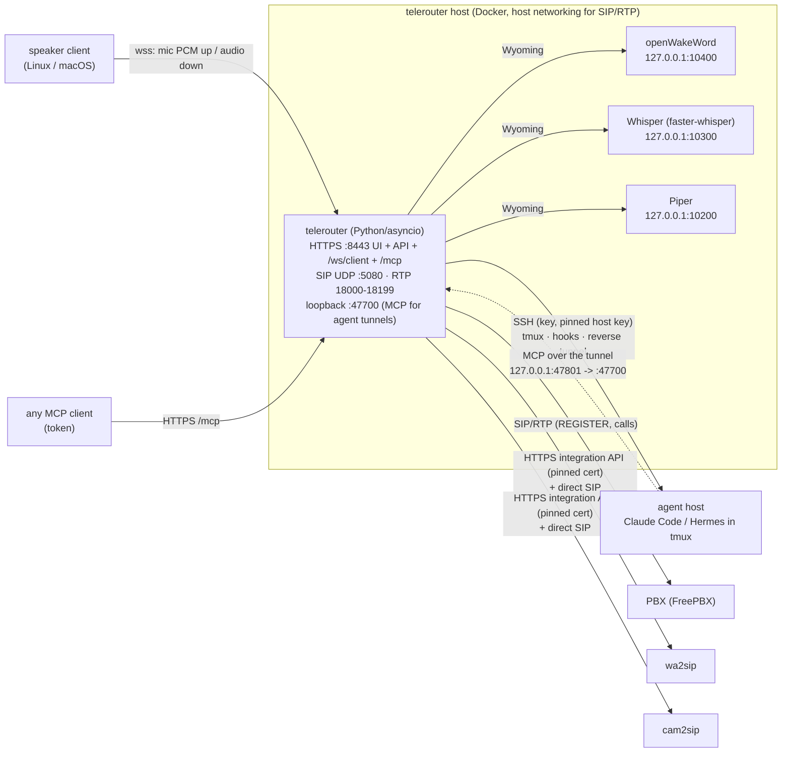
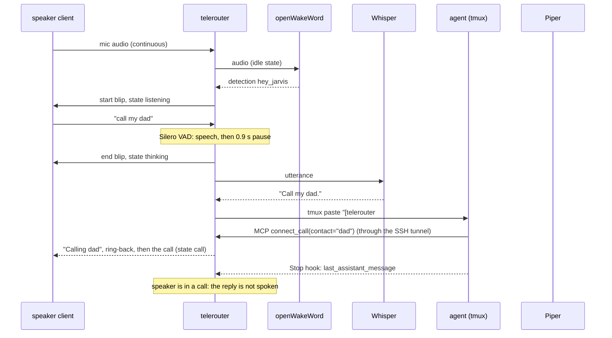

# Architecture

telerouter is two things in one Docker Compose app:

1. **A smart-speaker manager.** Small clients on Linux/macOS machines stream their microphone to the
   server and play what it sends back. The server listens for a wake word (openWakeWord), records what
   you say (Silero VAD), turns it into text (Whisper), hands it to an **AI agent** (Claude Code or Hermes)
   running in tmux on another machine over SSH, and speaks the answer (Piper).
2. **A voice router.** It is a SIP endpoint: it registers an extension on your PBX, calls **wa2sip**
   (WhatsApp) and **cam2sip** (cameras) directly, takes incoming calls, and bridges any of them to a
   speaker, to the agent, or to another call. The agent drives all of this through telerouter's own
   **MCP server**, and so can any other MCP client ("call my WhatsApp and tell me the build is done").

## 1. Components



| Process | Image | Exposed | Notes |
|---|---|---|---|
| telerouter | built here | `0.0.0.0:8443/tcp`, `5080/udp`, `18000-18199/udp`, `127.0.0.1:47700` | host network; uid 1000, read-only root, `cap_drop: ALL` |
| whisper | `rhasspy/wyoming-whisper:3.8.1` | `127.0.0.1:10300` | `small-int8` on CPU by default, `--initial-prompt` from `WHISPER_PROMPT` |
| piper | `rhasspy/wyoming-piper:2.5.2` | `127.0.0.1:10200` | downloads voices on first use into `piper-data/` |
| openwakeword | `rhasspy/wyoming-openwakeword:2.1.0` | `127.0.0.1:10400` | built-in models + `wake-models/*.tflite` |

## 2. Code map

```
telerouter/
  __main__.py          two uvicorn servers: public HTTPS app + loopback MCP app
  settings.py          TELEROUTER_* environment
  models.py            pydantic config (Pbx, Integration, Contact, Client, Agent, McpToken, settings)
  store.py             /data/config.json (0600, atomic), history.json
  security.py          argon2id, tokens (stored as SHA-256), TOTP, LoginThrottle, server-side sessions
  sso.py               single sign-on: OpenID Connect code flow + PKCE (e.g. Authentik), allowed users/groups
  tls.py               local CA + server certificate (re-issued when names change; CA stays)
  engine.py            wiring: SIP UA + accounts, agent runtimes, integration clients, contact lookups
  messaging.py         written chat: web page + Telegram bots (pairing, /session, footers), send_message; /data/messages.json
  scheduler.py         scheduled tasks: due runs, the three targets, the context reminder; /data/tasks.json
  cron.py              next run of a schedule (daily times, interval, once, 5-field cron)
  mcp.py               MCP server (Streamable HTTP, JSON responses, tools only)
  voice/
    client_conn.py     one speaker device connection (client): paced audio out, mic in, state
    speaker.py         VirtualSpeaker: a mic device + an output device; play/cue/live routing
    cast.py            Google Cast outputs: Cast v2 control (TLS :8009), mDNS discovery, plain-HTTP media listener
    assistant.py       wake -> listen -> STT -> agent -> TTS turn; mic routing; speakable()
    speech.py          Wyoming clients (Whisper, Piper, openWakeWord WakeStream)
    vad.py             Silero endpointing
  agents/
    ssh.py             telerouter's SSH key, host-key fetch/pin, connect
    drivers.py         Claude Code / Hermes: files, launch script, hook script, Hermes config edit
    runtime.py         AgentRuntime: SSH, reverse tunnel, tmux session, ask(), event tail
  router/
    calls.py           CallManager + CallSession (speaker / agent / mcp / bridge modes), inbound routing
    sipaudio.py        G.711 8 kHz <-> 16 kHz PCM, paced RTP, prompts, DTMF
    integrations.py    wa2sip/cam2sip integration API client (pinned TLS)
  sip/, media/         SIP stack + RTP/G.711/DTMF shared with wa2sip and cam2sip (MIT, same author)
  web/app.py           FastAPI: auth, admin API, /ws/client, client installer, /mcp
  web/static/          vanilla JS SPA (no build step, no inline script/style: strict CSP)
client/                telerouter-client (Python >= 3.9): enroll, run, devices, test-audio; install.sh
tests/                 pytest (auth paths, MCP, agents, SIP, TLS, voice, client)
tools/                 sip_phone.py (scriptable SIP phone), fake-agent/ (sshd + fake claude for tests)
```

## 3. Speakers

A **speaker** (`models.Speaker`, runtime `voice/speaker.py: VirtualSpeaker`) is what agents and the owner
talk to. It is built from devices: its **microphone** is an enrolled client (`Client`), its **output** an
enrolled client or a **Google Cast speaker** (`CastDevice`). The classic case is one client for both (every
enrolled client gets such a speaker, with the client's id); "odam" = the Raqqa laptop's mic + the Mi Smart
Speaker's loudspeaker. `Engine.sync_speakers()` turns config + connected devices into online
VirtualSpeakers (online = mic device connected and output there); a changed binding builds a new one, like
a reconnect. A microphone feeds one speaker (the API moves it). Device ids and speaker ids are separate
lists; MCP token allow-lists (`McpToken.clients`) and "ring a speaker" (`inbound_client`) hold speaker ids.

| VirtualSpeaker | audio | goes to |
|---|---|---|
| `play()` | answers, announcements, "Calling dad", incoming ring | the output |
| `cue()` | blips and thinking ticks | the output, or the mic device (`cues`; `auto` = mic device when the output is Cast) |
| `live()` | live call audio, ring-back | the output if `live_ok` (a client), otherwise the mic device |

Barge-in (AEC) only when mic and output are the same client. Wake detection pauses while any of the
speaker's outputs plays.

### 3.0 Google Cast outputs (`voice/cast.py`)

Control is Cast v2: TLS to the device's port 8009, length-prefixed protobuf `CastMessage` frames
(hand-encoded, six fields), JSON payloads; heartbeat PING/PONG. telerouter launches the Default Media
Receiver (`CC1AD845`) on first use (or ahead, `prepare()`, when a turn starts listening), keeps it, and stops
it after 5 idle minutes. Measured on a Mi Smart Speaker Lite (Cast firmware 1.52):

| what | result |
|---|---|
| launch the receiver | ~1.3-1.5 s |
| LOAD of a complete WAV -> PLAYING | ~0.15 s; `IDLE/FINISHED` arrives when playback ends |
| live WAV stream (unknown length) | starts only after ~7 s of 16 kHz audio is buffered, then stalls: unusable |

So `CastOutput` cuts audio into segments (what arrives within 120 ms: a sentence, a beep), LOADs each as a
complete WAV and waits for FINISHED (exact `drained()`); sentences that arrive while one plays become the
next segment. `flush()` sends media STOP. `live_ok = False`: calls play on the mic device. When the device
is unreachable the audio is handed to the speaker's mic device (`spill`) and the device is skipped for
60 s; its mDNS id finds it again after a DHCP move (`discover()`, `_googlecast._tcp.local`).

The receiver fetches the media itself, and Cast accepts HTTPS only with a publicly trusted certificate,
so `CastMedia` is a small plain-HTTP listener (`TELEROUTER_CAST_PORT`, 8480, started on first use): only
`GET /cast/<128-bit random>.wav`, only from the address of the device it was offered to, gone after
FINISHED or 60 s, 16 connections max, 8 KiB request head, no other paths.

### 3.1 Protocol

`wss://<server>:8443/ws/client` with `Authorization: Bearer trc_...` (the client's token), or
`X-Telerouter-Token: trc_...` when a reverse proxy in front uses `Authorization` itself (the phone app).

| direction | frame | meaning |
|---|---|---|
| client -> server | binary | microphone, 16 kHz mono PCM16 LE, 20 ms blocks |
| client -> server | `{"type":"hello","version","platform","aec","transcript","speech"}` | after connecting; `speech: false` = answers as text only |
| client -> server | `{"type":"button","action":"talk"\|"cancel"}` | optional push-to-talk |
| client -> server | `{"type":"assistant","open":true\|false}` | the app's voice assistant sheet opened or closed (kept on the device as `assistant_open` / `assistant_changed`) |
| server -> client | binary | audio to play, 16 kHz mono PCM16 LE, ~100 ms chunks |
| server -> client | `{"type":"state","state":...}` | idle, listening, thinking, speaking, ringing, call |
| server -> client | `{"type":"flush"}` | drop queued playback now (barge-in, call ended) |
| server -> client | `{"type":"ping"}` / `{"type":"config","volume","server_version","client_id","name"}` | keep-alive, settings, which device this is |

The server paces playback (≤250 ms ahead of real time), so it always knows when the client has
finished playing (`ClientConn.drained()`): blips end before listening starts, and wake-word detection is
paused while the speaker talks (unless the client cancels echo, see 3.3).

### 3.2 One voice turn (`voice/assistant.py`)



Mic routing by state: `idle` -> wake word; `listening` -> endpointer; `call` -> SIP call + wake word
(the wake word hangs up); `ringing` -> wake word (answers). While a call that is not on this speaker is in
progress, the wake word does not start a turn (a phone near the speaker saying "Hey Jarvis" must not trigger
it; Voice setting `wake_during_calls`). Whenever wake feeding resumes after a pause
the wake stream is reset (new AudioStart), otherwise the wake word that started the last turn, still in
openWakeWord's window, fires again.

### 3.3 Client

`client/telerouter_client`: PortAudio via `sounddevice` (Linux/macOS), opens the devices at 16 kHz or
resamples from their native rate; optional WebRTC echo cancellation + noise suppression (`livekit` APM,
the `aec` extra), fed with what it plays as the reverse stream. With AEC the server allows barge-in
(wake word while it speaks). `--input-wav/--output-wav` replace the devices for tests.

Enrollment: the admin creates a one-time code (15 min); the install command pins the server's public
key (`curl --pinnedpubkey`) and the CA fingerprint; the client downloads `/ca.pem`, checks its SHA-256,
then enrolls over TLS that trusts only that CA and gets a `trc_` token (only its hash is stored). The
installer creates a systemd user service (Linux) or a launchd agent (macOS).

### 3.4 Android app (separate repo, telerouter-android)

Since app 0.2 / telerouter 0.10 the app is telerouter's **web UI in a WebView** (the dashboard: every page and
setting, no second implementation to keep in step) plus native parts: the assistant (on-device wake word, the
conversation sheet) and a "This phone" screen. There is one address, the one the browser uses, and one sign-in:

1. The app opens `https://<address>/` in its WebView. A proxy in front (e.g. Authentik forward auth) shows its
   login; then telerouter's login page (password, or *Sign in with Authentik*, §7.1).
2. Once `/api/session` says logged in (the app checks with the WebView's cookies), the app adds the phone as a
   device with that admin session: `POST /api/clients/enroll` (CSRF) and `POST /api/client/enroll`. The `trc_`
   token is sealed in the Android Keystore; the user never sees a code.
3. Voice: `wss://<address>/ws/client` with `X-Telerouter-Token` and the WebView's cookies (the proxy's sign-in).
   A redirect or 401 from the proxy makes the app follow `/api/health` through the proxy's redirects (they come
   back at once while the identity provider's session lasts) and retry; otherwise the sheet asks to open the app.

The web UI knows it runs in the app (user agent `telerouter-android/<version>`) and adds links the app intercepts:
`telerouter-app://talk` (a *Talk* button in the phone top bar and the drawer) and `telerouter-app://assistant`
("This phone"). The WebView has no JavaScript bridge and honours these links only on telerouter's own origin.
On narrow screens the web UI has a top bar with the page name and a navigation drawer.

Protocol extensions the phone uses (all opt-in, old clients unaffected):

- `hello` with `"transcript": true`: the server sends `{"type":"transcript","role":"user"|"assistant","text"}`
  when it has heard a request (`listen`) and when it answers (`speak`). `VirtualSpeaker.transcript` sends them
  to the client devices of that speaker that asked for them. `"speech": false` (the app's *Spoken answers* off):
  `VirtualSpeaker.speaks_answers` is false and `speak()` sends the text without synthesizing it.
- `{"type":"button","action":"talk","cue":false}`: the phone detected the wake word itself (microWakeWord) and
  played its own start sound. `start_turn(cue=False)` sets the state to listening and installs the
  endpointer before returning, so the audio the phone sends right behind the message (what was said after
  "Hey Jarvis", buffered while the connection opened) reaches the endpointer instead of the wake word stream.
  This was verified end to end with real Whisper: "Call my mom please." sent right behind `talk` was
  transcribed whole.

**One "Hey Jarvis", two devices**: the speakers' wake word runs on the server and reacts first, while the phone
first has to connect. When a phone starts a turn with `cue: false`, any speaker that a wake word put into
listening within `SAME_WAKE_S` (4 s) stops (its turn is cancelled, its start beep cut off), and speaker wake
words in the 4 s after a phone's are ignored. The phone answers, as chosen by the owner.

App 0.1.x (setup links with a pinned LAN CA, `TELEROUTER_PUBLIC_URL`) still works: `/api/clients/enroll` still
returns `app_link`, and `Authorization: Bearer` still works on `/ws/client`.

## 4. Agents

`agents/runtime.py`, one `AgentRuntime` per agent:

1. SSH with telerouter's ed25519 key (`/data/ssh/id_ed25519`) to the configured user; the host key was
   fetched and confirmed by the admin (fingerprint shown) and is pinned.
2. Checks `tmux` and the agent binary, creates `~/.telerouter/<agent-id>/` (0700).
3. **Reverse tunnel**: `127.0.0.1:<mcp_remote_port>` on the agent host -> telerouter's loopback MCP
   listener. The agent reaches MCP without network access to telerouter and without trusting a
   self-signed certificate; the hop is inside SSH.
4. Writes the driver's files and starts `tmux new-session -d -s telerouter-<id> sh start.sh`. The owner
   can `ssh -t user@host tmux attach -t telerouter-<id>` and watch or type.
5. Tails `events.jsonl` over SSH (`tail -F`). The hook script only appends the hook's JSON as one line.

| | Claude Code | Hermes |
|---|---|---|
| launch | `claude --session-id/--resume <uuid> --model claude-sonnet-5-5 --effort medium --permission-mode auto --settings settings.json --mcp-config mcp.json --append-system-prompt "$(cat instructions.md)"` | `hermes chat -c telerouter-<id> --create-if-missing --accept-hooks [--model --provider --yolo]`, or `hermes -c ...` on CLIs older than 0.22 — start.sh probes `hermes chat --help` for the flag and picks, and records a failed launch's exit status in `last-exit` so `start_session` can report it instead of claiming success |
| hooks | from `--settings` (nothing in `~/.claude` changes): UserPromptSubmit, Stop, Notification | `post_llm_call`, `on_session_end` in `~/.hermes/config.yaml` (edited once, with a backup; allow-listed) |
| reply | Stop `last_assistant_message` (fallback: transcript tail) | `post_llm_call` `extra.assistant_response` |
| MCP | `mcp.json` (0600) with the agent's `trm_` token; `permissions.allow: mcp__telerouter` | `mcp_servers.telerouter` in config.yaml |
| voice rules | `--append-system-prompt` | appended to each request |

**Context management**: after every turn telerouter reads the context size from the transcript's last
`usage` (input + cache + output tokens) and puts it in the next voice request's header ("context 112k
tokens"). The agent-only MCP tools `context_status` and `reset_context(mode, keep)` let the agent decide to
compact (keeping what it names) or clear; telerouter types `/compact <keep>` / `/clear` (Hermes:
`/compress`) into the pane right after the current turn's Stop hook, never during a voice request.

**Extra MCP servers** (`Agent.mcp_servers`, e.g. Home Assistant's `/api/mcp`): added to Claude's
`mcp.json` (with `permissions.allow: mcp__<name>` when auto-approve is on) or to Hermes' `mcp_servers`
(telerouter remembers which names it added in `hermes-managed.json` and removes them again). HTTPS only
(plain http only for 127.0.0.1), bearer token write-only in the API; the voice instructions list them and tell
the agent to use them directly for smart-home requests. A server with a private certificate gets it pinned
(`ExtraMcpServer.tls_ca`). `POST /api/agents/mcp-certificate` fetches the top certificate of the chain the server
presents (its CA, unverified), and the admin compares the fingerprint before saving. The Claude driver writes the
pinned CAs to `extra-ca.pem` and start.sh exports `NODE_EXTRA_CA_CERTS`. Claude Code then adds them to the
public CAs, and hostname checks stay on (verified with Claude Code 2.1.303: "Failed to connect" without it,
"Connected" with it).

**Correlation**: each request carries a nonce (`[telerouter #a1b2 · Kitchen speaker] ...`). Claude: the
UserPromptSubmit event whose `prompt` contains the nonce names the session; the next Stop of that
session is the answer. Hermes: the `post_llm_call` whose `user_message` contains the nonce. Turns typed by
hand in tmux are ignored. Notification events during a voice request (permission prompts) are spoken
("Jarvis needs you at the terminal: ...").

Start-up dialogs (workspace trust, permission-mode confirmations) are recognised on the pane and
answered. Changing model/effort/permissions/instructions restarts the session (Claude resumes the same
conversation by its session id; "New conversation" starts a fresh one).

### 4.0 Quiet hours (`quiet.py`)

`Quiet.active()` checks the local time window (crossing midnight). During it, `VoiceAssistant._quiet_wait`
stops waiting for an agent answer after `long_task_minutes` and says nothing (ticks stop too; the agent keeps
working). `Quiet.calls_allowed()` blocks incoming calls (`CallManager.on_incoming` rejects them) and the MCP
tools that would ring or talk on their own (`phone_message`, `start_voice_call`, `announce`, `ask_speaker`,
`connect_call` without a live voice request), unless Home Assistant says the owner is at the desk: a chosen
motion/occupancy sensor is on, or was on within `desk_hold_minutes` (`/api/states`, cached 20 s, using an
agent's Home Assistant MCP server URL + token unless set explicitly).

### 4.1 Machines and tmux sessions

A **Machine** (`models.Machine`) is an SSH target with a pinned host key and the agent type its tmux
sessions run. Agents run on a machine (their SSH fields are copied from it; 0.3 configs are migrated, with a
backup of config.json). `agents/machine.py` keeps one SSH connection per machine, lists `tmux list-sessions`
every 60 s (except telerouter's own `telerouter-*`), and the engine merges them into connections of kind
`tmux` (missing ones are marked gone).

Talking to a session telerouter did not start (no hooks of its own there): Claude Code writes
`~/.claude/sessions/<pid>.json` for the claude process in the pane, naming the live session id and so its
transcript. telerouter notes the transcript's length, pastes the request (with a nonce) into the pane and
waits for the `system`/`turn_duration` entry after it; the last assistant text of that turn is the answer.
Hermes: its hooks are global to the host's install, so the `events.jsonl` of any telerouter Hermes agent
there records every session's turns, including task sessions and sessions other people started.
`post_llm_call` carries the turn's final answer next to the prompt that started it (our nonce), and the
answer is read from there by a small reader script kept on the machine (the event's `conversation_history`
would otherwise be ~1 MB over SSH). Only when no such file exists does telerouter watch the pane, and that
path cuts reasoning, tool calls and TUI chrome into the answer.

**Routing**: MCP `connect_call` with a tmux contact (or the UI's *Connect*) puts a `Route` on the speaker or
the phone call. Their following requests go to the session instead of the agent; a short "back to <agent>",
"disconnect" or "leave the session" (≤ 7 words) ends it, and so do 15 idle minutes.

**New sessions** (MCP `new_session`, agent-only scope, machines with `allow_new_sessions`): telerouter runs
`mkdir -p <folder> && tmux new-session -d -s <name> -c <folder> '<agent>; exec $SHELL -l'` over the machine's
SSH connection (`claude -n <name> [--model] [--permission-mode]`, from the machine's new-session settings;
`hermes` on Hermes machines), answers Claude Code's start-up dialogs (workspace trust, auto mode) on the
pane (arrow keys first, Enter only once the screen shows the right option selected: the dialog is drawn
before it reads keys, and a lost arrow + Enter would pick the preselected "No, exit"), waits until the UI is still and `~/.claude/sessions/<pid>.json` exists (so the first routed request
finds the transcript; on Hermes it waits for the TUI to draw and stop changing - a prompt typed into a
booting screen is lost, and the banner it shows is what a pane reader would call the answer), lists the
sessions (the new one becomes a tmux contact) and routes the requester to
it. Names: `[A-Za-z0-9][A-Za-z0-9_.-]{0,39}`, not `telerouter-*`, not an existing session; folders: plain
paths without `..` (quoted; `~` = the SSH user's home).

### 4.2 Scheduled tasks (`scheduler.py`)

A `ScheduledTask` (config) holds the prompt, the target and the schedule; the run state (next run time,
the last 20 runs, the task's sessions, the context size it was last reminded at) lives in `/data/tasks.json`,
so config.json is not rewritten every run. `Scheduler.loop()` ticks every 15 s and starts due runs. One run per
task at a time: a run that comes due while the previous one is going on is recorded as skipped. A one-off
task turns itself off after it ran. At start-up, runs cut off by the restart are marked failed, and a run
missed while telerouter was down still runs if it was due less than 15 minutes ago. Older missed runs are
skipped.

| Target | What a run does |
|---|---|
| `agent` | `AgentRuntime.ask(prompt, Source("schedule", 'scheduled task "X"'), timeout)`: the agent's ongoing conversation. Other requests to that agent fail fast with "busy with the scheduled task" while it runs, instead of waiting up to an hour behind its lock |
| `new_session` | `MachineRuntime.new_session("<slug>-MMDD-HHMM", folder, by_admin=True)`, then `ask(..., header=...)`. The sessions beyond `keep_sessions` (the oldest ones this task started) are closed |
| `task_session` | the task's own session `task-<slug>` (or its `session_name`), created when missing (or killed and created again when the task started it but its claude has exited), then `ask`. Afterwards: the context check |

Prompts are headed `[telerouter #nonce · scheduled task "X" (date time): an automatic run nobody is
watching. Do the task, then end with a short summary of the result (telerouter keeps it)]`, not as spoken
requests. With `calls: "task"` the header (or, for an agent, a line after the prompt) adds "Don't phone,
message or announce anything about this run unless the task asks you to". MCP `_source()` treats a
scheduled run like the agent acting on its own (no requesting speaker, quiet hours apply).

**Context reminder** (`task_session`, Claude Code, `context_limit_k` > 0): after the run telerouter reads the
context size from the session's transcript (the usage of the last assistant message). At or above the limit
it sends a gentle note: the size, the advised size, that this is only a suggestion, and how to answer.
`TELEROUTER_CLEAR` on its own line makes telerouter type `/clear`, `TELEROUTER_COMPACT: <keep>` makes it type
`/compact <keep>`, and anything else ("keeping it") makes telerouter remember the size and remind again only
after the context grew by another 10% of the limit. `/clear` gives the session a new id; Claude Code
updates `~/.claude/sessions/<pid>.json`, so the next run finds the new transcript (verified on 2.1.303).

### 4.3 The tmux page (`tmux.py`, `machine.py`)

The *tmux sessions* page lists every tmux session on every machine — including the sessions of telerouter's
own agents, which the connections list leaves out — with the agent running in each, opens one as a terminal
in the browser, starts sessions and closes them. `telerouter/tmux.py` holds the command lines and the
parsers (pure functions, no I/O) so the standalone `tmux_manager` app ships the same file.

**Text, never a video stream.** The pane is read with `tmux capture-pane -p -e` (visible screen; `-S -N` adds
scrollback when the page asks for history) and drawn by the browser itself: `app.js` parses the SGR escapes
into coloured spans (`termLines`/`termSpan`). Typing goes in with `set-buffer` + `paste-buffer` (bracketed
paste, so a multi-line message arrives as one inserted text) and `send-keys` for a single keysym — only
keysyms in `KEYS_RE` are accepted, so the API can never be talked into an arbitrary `send-keys` argument
list. There is no VNC/noVNC/ScreenCast, no websocket and no frames: a refresh is a few KB, it stays sharp at
any zoom and on a phone, and the text can be selected and copied. A still pane costs no payload at all: the
screen response carries a hash of what was drawn and answers `{"same": true}` while nothing changed.

**Which agent is in a session.** One `list-sessions -F` per machine plus one `ps -eo pid=,ppid=,args=` (cached
3 s, the page polls): the agent is found by walking the pane's descendants, because the pane's own command is
often only `bash`/`sh`/`node` — Claude Code is a `claude` binary, Hermes runs as `python3 -I -c <launcher>`
with `hermes-agent`/`hermes_cli` in its argv (`AGENT_HINTS`). A session that matches one of telerouter's
agents by its configured `tmux_session` is labelled with that agent's name, config first and pane second.
Sessions a **scheduled task** uses are marked too (`Engine.task_sessions`): a `task_session`'s own session
(`<name>`/`task-<name>`) and every per-run session a `new_session` task still keeps, so the page says which
runs belong to which task instead of leaving a session nobody recognises.

**API** (all admin + CSRF like every `/api/` route): `GET /api/tmux` (machines queried concurrently; a broken
machine reports its error instead of hiding the others), `GET /api/tmux/{machine}/{session}?history&hash`,
`POST …/send {text, key, enter}`, `POST /api/tmux/{machine} {name, folder, run}`, `DELETE …/{session}`.

**Creating**: `mkdir -p <folder> && tmux new-session -d -s <name> -c <folder> '<launch>; echo; echo "the agent
exited"; exec $SHELL -l'` with `run` = the machine's agent kind, `claude`, `hermes` or `shell` (a bare session).
An agent session's start-up dialog (workspace trust, auto mode) is answered in the background by the same
`_settle` routine the agents' own sessions use, so the page shows it being answered rather than waiting.

**Closing** is refused for a session that belongs to one of telerouter's agents — it would be restarted at
once; the Agents page owns those. Everything goes over the machine's existing asyncssh connection, so there
is no extra port and nothing to install on the host. The pane keeps its own size (the browser scrolls
horizontally); the page never resizes an agent's TUI, which would corrupt a running Claude Code/Hermes layout.

### 4.4 Messaging (`messaging.py`)

A **chat** is the web page (`web`) or one paired Telegram chat (`tg:<bot id>:<chat id>`). Every chat has a
target: the default agent (`AgentRuntime.ask` with `Source("message", ...)`) or one tmux session
(`MachineRuntime.ask(..., header=...)`, the same path as a voice route). The header says "text message ... not
for text-to-speech", so the answer is written text; `drivers.prompt_text` drops Hermes' spoken-request suffix for
it. Targets and the last 500 messages live in `/data/messages.json` (0600).

* **Telegram** (`BotRuntime`): long polling `getUpdates` (25 s) with httpx (TLS verified, no redirects), plain-text
  messages only. The token is in the request path, so the `httpx` logger is silenced and errors are reported by
  class name, never by `str(exc)`. A Telegram update never blocks the poll loop (one task per update); a chat's
  messages are serialised by a per-chat lock; `sendChatAction` keeps "typing…" alive while the agent works.
* **Who may talk** (threat model): only *private* chats listed in `TelegramBot.allowed_chats`. Pairing: the admin
  UI asks for a one-time code (8 characters, 10 minutes, stored only as SHA-256 in memory, tied to one bot);
  `/start <code>` from an unknown chat adds it. Five wrong codes block that chat for 15 minutes. Strangers,
  groups and non-text messages get no answer, so the bot reveals nothing. Slash commands are handled by telerouter
  and never typed into an agent.
* **`/session`** lists `choices()`: the default agent first, then every session the machine runtimes know (the
  list is refreshed when asked). Telegram buttons carry an index into the list that chat was shown (`s:<n>`).
* **Footer**: every agent answer ends with `— <agent> · tmux <session> on <machine>` (a routed foreign session:
  `— tmux <session> on <machine>`), stored apart from the text (`footer`) and appended at send time.
* **`send_message`** (MCP scope `messaging`; telerouter's own agent tokens have it implicitly) writes to every
  paired chat of every connected bot and to the page; 4000 characters, 20 a minute per token.
* API (all behind the session + CSRF checks): `GET /api/messaging`, `GET|POST /api/messages`,
  `PUT /api/messages/target`, `POST|PUT|DELETE /api/messaging/bots[/id]`, `POST .../pair`,
  `DELETE .../chats/<id>`. `allowed_chats` cannot be set through the API; the token is write-only.

## 5. Calls

`router/calls.py`. Every call is a `CallSession` with one SIP leg (`router/sipaudio.py`: G.711 <-> 16 kHz,
20 ms pacing, prompts above live audio, ring-back tone, RFC 4733/INFO DTMF) and a mode:

| mode | what | started by |
|---|---|---|
| speaker | contact <-> speaker client (live) | MCP `connect_call` from a speaker request, UI "Call", inbound "ring speaker" |
| agent | inbound caller talks to the agent: greeting, blip, listen, STT, agent, TTS, loop | inbound policy "talk to agent" |
| mcp | the agent talks itself: `start_voice_call` + `say`/`listen`/`hang_up`, `phone_message` | MCP |
| bridge | phone caller <-> another contact (the caller asked the agent to connect them) | MCP `connect_call` from a phone request |
| ringbridge | your own extension rings, then the contact is dialled and the two legs are joined ("call mom" from the phone app) | MCP `connect_call` with `ring_first` (the default for phone-app requests when *Ring me first* is set) |

### 5.1 Where calls go

| contact kind | how telerouter dials |
|---|---|
| pbx | its PBX extension (REGISTERed account `pbx`), digest auth |
| whatsapp | wa2sip `POST /api/integration/v1/calls {target}` -> one-time `sip:tr…@wa2sip:5064`; direct INVITE. wa2sip answers 180 while WhatsApp rings, 200 when answered, 486/404/603/480 otherwise |
| camera | cam2sip, same API; answered at once (camera intercom) |

### 5.2 Incoming

- **PBX**: INVITEs for the PBX account are accepted only from the PBX's address.
- **Direct** (wa2sip ringing us for a WhatsApp call): to `sip:<inbound_secret>@telerouter:5080`, only from
  the address of a linked integration. wa2sip sends `X-Telerouter-Target: <account>:<number>@c.us` and the
  caller's number in P-Asserted-Identity.
- The caller is matched to a contact; its **inbound policy** decides: talk to an agent (optionally after a
  DTMF PIN), ring a speaker (announce + ring; the wake word answers), or reject (603). Unknown callers
  are rejected by default.

### 5.3 Ringing bridge

`CallSettings.ring_first_contact` names your own extension (a contact id, "" = off). `ring_bridge()` dials
it first: the PBX rings your phone; when you answer, telerouter says "Connecting you to X." on that leg
(unless *Say "Calling …"* is off), dials the contact with a local ring-back tone until it is answered, and
then joins the two legs as raw G.711 in both directions (`SipAudio.send_g711`, no resampling, no prompts).
If the contact does not answer you hear why and the call ends; if you hang up, both legs go. The session's
own `call` is the target leg and `me_call` is yours, so `_cleanup` hangs up both.

`connect_call` uses it when the request came from the phone app (the device's `platform` says android/ios)
and `ring_first_on_phone` is on — that is how "Hey Jarvis, call my mom" on the phone becomes an ordinary
phone call instead of audio inside the app. An explicit `speaker` or `ring_first: false` keeps the old
speaker behaviour; `ring_first: true` forces the ringing bridge (also from a home speaker, or when an agent
calls on its own).

## 6. MCP server

Streamable HTTP, JSON responses, stateless, tools only (`mcp.py`). Endpoints: `POST https://…:8443/mcp`
and the loopback listener used by agent tunnels. `Authorization: Bearer trm_…` (SHA-256 stored). Scopes:
`contacts`, `calls`, `speak`, `clients`; plus allow-lists of contacts and speakers.

| tool | scope | |
|---|---|---|
| list_contacts | contacts | referred names, kind, notes, number |
| list_speakers | clients | online state; `assistant_open` / `assistant_changed_at` from the device (false = the phone app's sheet was closed, so answer by calling instead); tells the agent which speaker the current request came from |
| connect_call | calls | contact <-> requesting speaker / named speaker / bridge the phone caller / ring me first (`ring_first`) |
| phone_message | calls | ring, speak a message (repeat), optionally record a spoken reply, hang up |
| start_voice_call, say, listen, hang_up, list_calls | calls | agent-led conversation |
| announce, ask_speaker | speak | talk/ask through a speaker |
| context_status, reset_context | (agents telerouter runs) | own context size; compact/clear after the current reply |
| new_session | (agents telerouter runs) | new tmux session with a fresh agent on a machine that allows it; connects the requester |

The SDK's FastMCP API changed in mcp 2.x; the protocol surface needed here (initialize, ping,
tools/list, tools/call, notifications) is small, so it is implemented directly and tested.

## 7. Security and threat model

**Assets**: the agent (it can run commands on its host), the PBX/WhatsApp/camera reach (calls cost
money, privacy), the microphones in the house, and the credentials telerouter holds (PBX secret,
integration tokens, SSH key).

| Threat | Mitigation |
|---|---|
| Someone on the LAN claims the first admin account | setup needs a one-time setup code printed in the container log (or `TELEROUTER_SETUP_CODE`) |
| Password guessing | argon2id; per-IP and per-account throttle with growing locks + global cap; generic errors; constant-time compares; optional TOTP (replay-protected) |
| Session theft / CSRF / clickjacking | server-side sessions (`__Host-` cookie, Secure, HttpOnly, SameSite=Strict), rotated on login, idle + absolute timeouts, logout and password change delete them; CSRF token on every state change + Fetch-Metadata refusal; `X-Frame-Options: DENY`, `frame-ancestors 'none'` |
| XSS | strict CSP (`script-src 'self'`, no inline script/style), DOM built with `textContent` only |
| Plain-text credentials on the wire | HTTPS only (self-signed CA; clients and the installer pin it); integrations over HTTPS with a pinned certificate; agent MCP inside SSH |
| Stolen/leaked tokens | random 256-bit tokens, only SHA-256 stored, sent in headers, revocable (speaker removal, MCP token revoke, integration token rotation); agent MCP token rotates on every session start; secrets write-only in the API |
| Rogue speaker client | needs an enrollment code (single use, 15 min, throttled); WebSocket frames size/rate capped; max clients |
| Eavesdropping on Cast speaker audio | Cast receivers fetch media only over plain HTTP (no publicly trusted certificate on a LAN): what a Cast output plays (answers, announcements; never live calls or microphone audio) crosses the LAN unencrypted. Single-use 128-bit URLs, served only to that device's address, withdrawn after playback / 60 s; the listener runs only once a Cast output is used. The Cast control channel is TLS but unauthenticated (device certificates are self-signed and rotate; Cast device auth is not implemented), so a LAN attacker who impersonates the device can get those URLs too. Don't use Cast outputs for private answers on an untrusted network |
| Rogue Cast device address | admin-only; telerouter only sends control messages and serves the offered WAV to it; mDNS updates the address only for the stored device id |
| Spoofed SIP INVITEs | PBX account only from the PBX's IP; direct address is a 128-bit secret and only from linked integrations' IPs; unknown callers rejected; optional DTMF PIN before the agent; wa2sip/cam2sip tickets are single-use, 30 s, bound to the requesting IP |
| Spoofed caller ID on the PBX | caller policy per contact; use the agent PIN if the PBX takes calls from outside |
| A voice request makes the agent do harm | the agent runs with the permission mode you choose (default `auto`); permission prompts are announced, never auto-approved; the agent instructions forbid calling anyone not asked for; MCP tokens can be limited to contacts/speakers |
| Voice reaches your coding sessions | tmux sessions are only reachable when visible (ticked) under Connections and allowed by the token; callers who may talk to the agent can also be routed there, so keep inbound "talk to agent" for trusted callers (+PIN) |
| Voice starts new agents on a machine | `new_session` only for telerouter's own agents (not for MCP tokens), only on machines where the admin enabled it (off by default), with the admin's model/permission mode; name and folder are validated and shell-quoted; the agent runs as that machine's SSH user, like the sessions you start yourself |
| Scheduled tasks run prompts unattended | only the admin creates them (UI/API with session + CSRF; no MCP tool); sessions start as the machine's SSH user with the machine's new-session model/permission mode (`by_admin` skips only the agents' `allow_new_sessions` switch); session names and folders validated and shell-quoted; only sessions the task started are closed; quiet hours still gate the calls they make; a run has a timeout |
| Single sign-on lets someone else in | off by default; the admin lists allowed user names/e-mails (verified e-mails only)/groups; code flow with PKCE, a random `state` bound to a `SameSite=Lax` cookie in the browser that started it (login CSRF), single-use, 10 min; `nonce`; the code is traded with the provider over verified TLS and the ID token's issuer, audience, expiry and nonce are checked (signature not needed for a token received directly from the token endpoint, OIDC Core 3.1.3.7); failures throttle the IP and only "failed" reaches the browser; changing the SSO settings needs the admin password (a stolen session can't add its own provider); the client secret is write-only. The provider's login (and its 2FA) replaces telerouter's for that sign-in |
| Phone app behind a sign-in proxy | the WebView loads only https, never skips certificate errors, has no JavaScript bridge; links to other sites from telerouter's pages open the browser (sign-in redirects stay in the app); `telerouter-app://` links work only from telerouter's origin; the device token is Keystore-sealed and sent in its own header; the app adds itself only with a logged-in admin session, and *Sign out* deletes its device (token revoked) |
| Exposing the phone endpoints to the internet (`TELEROUTER_PUBLIC_URL`, app 0.1.x) | only `/ws/client` (bearer `trc_` token, 256-bit, hashed; per-IP throttle on bad tokens) and `/api/client/enroll` (one-time 15-min code, throttled) are meant to be proxied; the admin UI stays on the LAN; set `TELEROUTER_TRUSTED_PROXIES` so throttles see real client IPs; a lost phone is revoked by removing its device |
| MITM of an extra MCP server with a private certificate | its CA is pinned per server after the admin compared the fingerprint; the agent still checks the host name; the pinned CA is trusted only by that agent's Claude Code process |
| MITM of the SSH connection | host key fetched once, shown as a fingerprint, pinned |
| Agent host compromise reaching telerouter | its MCP token only reaches MCP tools; telerouter never accepts commands from the agent host otherwise |
| SSRF via integration URLs | admin-only, HTTPS only, no redirects followed; the SIP address from the integration is rewritten to the integration's own host |
| Container escape / privilege | non-root uid 1000, read-only root fs, `cap_drop: ALL`, `no-new-privileges`, speech services bound to 127.0.0.1 |

Not covered: SIP over TLS/SRTP (the PBX side is UDP/RTP on the LAN like the rest of the user's setup);
the speech services trust anyone on the host's loopback.

### 7.1 Single sign-on (`sso.py`)

`GET /api/oidc/start` (only when enabled) discovers the provider (`<issuer>/.well-known/openid-configuration`,
cached 1 h; its `issuer` must match, its endpoints must be https), keeps `state` → (hash of a binding value,
nonce, PKCE verifier, redirect URI) in memory (10 min, max 100), sets the binding value as the cookie
`__Host-telerouter-sso` (`SameSite=Lax`, so the provider's redirect back carries it) and redirects to the
provider. `GET /api/oidc/callback` pops the state, compares the cookie, trades the code (with the verifier and
`client_secret_basic`, or `_post` if that is all the provider offers), checks the ID token's claims, merges the
userinfo answer (same `sub`), and matches `preferred_username`/`nickname`/verified `email` against the allowed
users, or `groups` against the allowed groups. Success starts a normal session (no TOTP step); every failure
ends at `/?sso=failed` and in the log with the reason. The redirect URI is `https://<Host>/api/oidc/callback`,
with `X-Forwarded-Host` instead of Host when the request comes from `TELEROUTER_TRUSTED_PROXIES` (Caddy sends
the upstream's address as Host towards an https upstream). The provider checks it against its registered URIs.

## 8. Design decisions

| Decision | Why |
|---|---|
| Wyoming services (Rhasspy images) for Whisper/Piper/openWakeWord | maintained images, standard protocol, swap models without code changes; isolated processes |
| Wake word on the server, mic streamed | the user asked for streaming clients; one place to change wake words; clients stay tiny |
| Agent in tmux + hooks, not `claude -p` | the owner can attach and watch or take over; a persistent conversation; hooks give exact turn ends (no screen scraping) |
| Reverse SSH tunnel for MCP | no network path from the agent host to telerouter needed, no CA trust on the agent host, encrypted |
| Direct SIP to wa2sip/cam2sip with one-time addresses | no PBX extension needed per contact, no IVR digit games; the integration API gives names/ids |
| Own MCP implementation | small surface, no dependency on a moving SDK API |
| Phone app = the web UI in a WebView + native assistant | the same features and settings as the browser by construction (no second UI to keep in step); only what a page can't do is native (wake word, the sheet, the assistant role, screen and audio settings) |
| SSO by OpenID Connect, not by trusting a proxy's user header | a header like `X-authentik-username` is only as safe as every path to telerouter (another proxy host without forward auth could forge it); OIDC needs no trust in the network path |
| Shared SIP stack with wa2sip/cam2sip | proven against FreePBX 17; same author |
