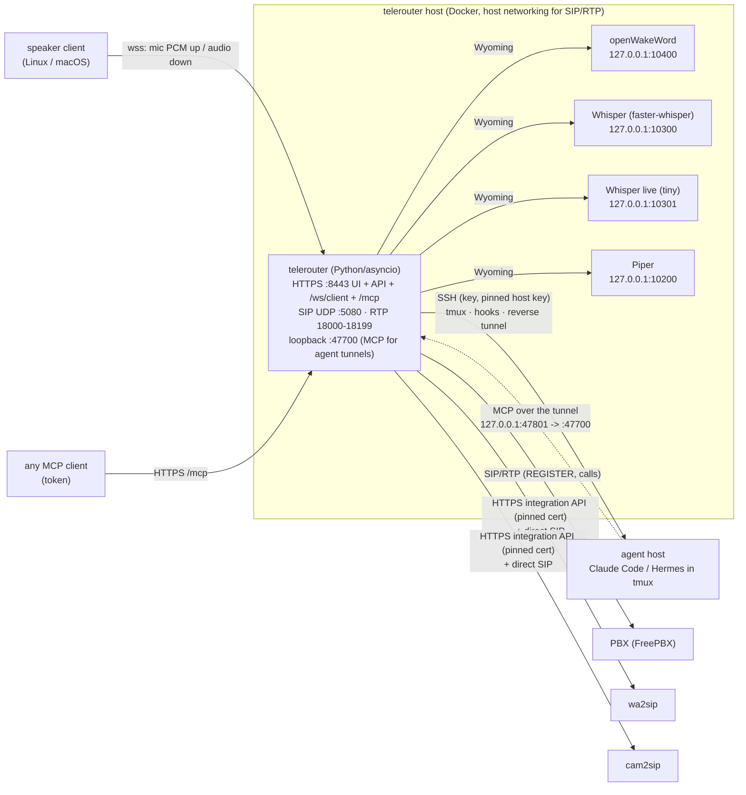

# Architecture

telerouter is two things in one Docker Compose app:

1. **A smart-speaker manager.** Small clients on Linux/macOS machines stream their microphone to the
   server and play what it sends back. The server listens for a wake word (openWakeWord), records what
   you say (Silero VAD), turns it into text (Whisper), hands it to an **AI agent** (Claude Code or Hermes)
   running in tmux on another machine over SSH, and speaks the answer (Piper).
2. **A voice router.** It is a SIP endpoint: it registers an extension on your PBX, calls **wa2sip**
   (WhatsApp) and **cam2sip** (cameras) directly, takes incoming calls, and bridges any of them to a
   speaker, to the agent, or to another call. The agent drives all of this through telerouter's own
   **MCP server**, and so can any other MCP client ("call my WhatsApp and tell me the build is done").

## 1. Components



| Process | Image | Exposed | Notes |
|---|---|---|---|
| telerouter | built here | `0.0.0.0:8443/tcp`, `5080/udp`, `18000-18199/udp`, `127.0.0.1:47700` | host network; uid 1000, read-only root, `cap_drop: ALL` |
| whisper | `rhasspy/wyoming-whisper:3.8.1` | `127.0.0.1:10300` | `small-int8` on CPU by default, `--initial-prompt` from `WHISPER_PROMPT` |
| piper | `rhasspy/wyoming-piper:2.5.2` | `127.0.0.1:10200` | downloads voices on first use into `piper-data/` |
| openwakeword | `rhasspy/wyoming-openwakeword:2.1.0` | `127.0.0.1:10400` | built-in models + `wake-models/*.tflite` |

## 2. Code map

```
telerouter/
  __main__.py          two uvicorn servers: public HTTPS app + loopback MCP app
  settings.py          TELEROUTER_* environment
  models.py            pydantic config (Pbx, Integration, Contact, Client, Agent, McpToken, settings)
  store.py             /data/config.json (0600, atomic), history.json
  security.py          argon2id, tokens (stored as SHA-256), TOTP, LoginThrottle, server-side sessions
  sso.py               single sign-on: OpenID Connect code flow + PKCE (e.g. Authentik), allowed users/groups
  tls.py               local CA + server certificate (re-issued when names change; CA stays)
  engine.py            wiring: SIP UA + accounts, agent runtimes, integration clients, contact lookups
  messaging.py         written chat: web page + Telegram bots (pairing, /session, footers), send_message; /data/messages.json
  memory.py            shared memory between agents: messages, status, notes in folders; SQLite /data/memory.db
  scheduler.py         scheduled tasks: due runs, the three targets, the context reminder; /data/tasks.json
  screens.py           smart display screens: the `display` message (layout, VNC credentials, task summaries)
  apisessions.py       Sessions API (/v1): apps start agent sessions with a task; /data/api_sessions.json
  cron.py              next run of a schedule (daily times, interval, once, 5-field cron)
  mcp.py               MCP server (Streamable HTTP, JSON responses, tools only)
  gateway.py           MCP gateway: client of external MCP servers, re-serves their tools on /mcp as <name>__<tool>
  gmail.py             Gmail: Google OAuth (code + PKCE) for the owner's accounts, Gmail REST client (RestMail), gmail_* MCP tools
  gmail_imap.py        Gmail with an app password instead: IMAP (X-GM-EXT-1) + SMTP backend (ImapMail), same tools
  voice/
    client_conn.py     one speaker device connection (client): paced audio out, mic in, state
    speaker.py         VirtualSpeaker: a mic device + an output device; play/cue/live routing
    cast.py            Google Cast outputs: Cast v2 control (TLS :8009), mDNS discovery, plain-HTTP media listener
    assistant.py       wake -> listen -> STT -> agent -> TTS turn; mic routing; speakable()
    speech.py          Wyoming clients (Whisper, Piper, openWakeWord WakeStream)
    vad.py             Silero endpointing
    live.py            LiveTranscriber: Whisper starts at the first pause; live words for screens
  agents/
    ssh.py             telerouter's SSH key, host-key fetch/pin, connect
    drivers.py         Claude Code / Hermes: files, launch script, hook script, Hermes config edit
    runtime.py         AgentRuntime: SSH, reverse tunnel, tmux session, ask(), event tail
  router/
    calls.py           CallManager + CallSession (speaker / agent / mcp / bridge modes), inbound routing
    sipaudio.py        G.711 8 kHz <-> 16 kHz PCM, paced RTP, prompts, DTMF
    integrations.py    wa2sip/cam2sip integration API client (pinned TLS)
  sip/, media/         SIP stack + RTP/G.711/DTMF shared with wa2sip and cam2sip (MIT, same author)
  web/app.py           FastAPI: auth, admin API, /ws/client, client installer, /mcp
  web/static/          vanilla JS SPA (no build step, no inline script/style: strict CSP)
client/                telerouter-client (Python >= 3.9): enroll, run, devices, test-audio; install.sh;
                       display.py = the smart display page (loopback HTTP + Server-Sent Events);
                       vnc.py = view-only VNC (RFB) viewer, camera.py = RTSP camera viewer (ffmpeg)
tests/                 pytest (auth paths, MCP, agents, SIP, TLS, voice, client)
tools/                 sip_phone.py (scriptable SIP phone), fake-agent/ (sshd + fake claude for tests)
```

## 3. Speakers

A **speaker** (`models.Speaker`, runtime `voice/speaker.py: VirtualSpeaker`) is what agents and the owner
talk to. It is built from devices: its **microphone** is an enrolled client (`Client`), its **output** an
enrolled client or a **Google Cast speaker** (`CastDevice`). The classic case is one client for both (every
enrolled client gets such a speaker, with the client's id); "odam" = the Raqqa laptop's mic + the Mi Smart
Speaker's loudspeaker. `Engine.sync_speakers()` turns config + connected devices into online
VirtualSpeakers (online = mic device connected and output there); a changed binding builds a new one, like
a reconnect. A microphone feeds one speaker (the API moves it). Device ids and speaker ids are separate
lists; MCP token allow-lists (`McpToken.clients`) and "ring a speaker" (`inbound_client`) hold speaker ids.

| VirtualSpeaker | audio | goes to |
|---|---|---|
| `play()` | answers, announcements, "Calling dad", incoming ring | the output |
| `cue()` | blips and thinking ticks | the output, or the mic device (`cues`; `auto` = mic device when the output is Cast) |
| `live()` | live call audio, ring-back | the output if `live_ok` (a client), otherwise the mic device |

Barge-in (AEC) only when mic and output are the same client. Wake detection pauses while any of the
speaker's outputs plays.

### 3.0 Google Cast outputs (`voice/cast.py`)

Control is Cast v2: TLS to the device's port 8009, length-prefixed protobuf `CastMessage` frames
(hand-encoded, six fields), JSON payloads; heartbeat PING/PONG. telerouter launches the Default Media
Receiver (`CC1AD845`) on first use (or ahead, `prepare()`, when a turn starts listening), keeps it, and stops
it after 5 idle minutes. Measured on a Mi Smart Speaker Lite (Cast firmware 1.52):

| what | result |
|---|---|
| launch the receiver | ~1.3-1.5 s |
| LOAD of a complete WAV -> PLAYING | ~0.15 s; `IDLE/FINISHED` arrives when playback ends |
| live WAV stream (unknown length) | starts only after ~7 s of 16 kHz audio is buffered, then stalls: unusable |

So `CastOutput` cuts audio into segments (what arrives within 120 ms: a sentence, a beep), LOADs each as a
complete WAV and waits for FINISHED (exact `drained()`); sentences that arrive while one plays become the
next segment. `flush()` sends media STOP. `live_ok = False`: calls play on the mic device. When the device
is unreachable the audio is handed to the speaker's mic device (`spill`) and the device is skipped for
60 s; its mDNS id finds it again after a DHCP move (`discover()`, `_googlecast._tcp.local`).

The receiver fetches the media itself, and Cast accepts HTTPS only with a publicly trusted certificate,
so `CastMedia` is a small plain-HTTP listener (`TELEROUTER_CAST_PORT`, 8480, started on first use): only
`GET /cast/<128-bit random>.wav`, only from the address of the device it was offered to, gone after
FINISHED or 60 s, 16 connections max, 8 KiB request head, no other paths.

### 3.1 Protocol

`wss://<server>:8443/ws/client` with `Authorization: Bearer trc_...` (the client's token), or
`X-Telerouter-Token: trc_...` when a reverse proxy in front uses `Authorization` itself (the phone app).

| direction | frame | meaning |
|---|---|---|
| client -> server | binary | microphone, 16 kHz mono PCM16 LE, 20 ms blocks |
| client -> server | `{"type":"hello","version","platform","aec","transcript","speech","stt"}` | after connecting; `speech: false` = answers as text only; `stt: "device"` = the client recognises speech itself |
| client -> server | `{"type":"utterance","text"}` | (`stt: "device"`) what the person said, recognised on the device: answers a waiting listen, or starts a turn when idle; `""` = nothing said |
| client -> server | `{"type":"wake"}` | (`stt: "device"`, 0.16.1) the phone started listening itself on an open connection (wake word, tap): speakers the same "Hey Jarvis" woke stand down |
| client -> server | `{"type":"button","action":"talk"\|"cancel"}` | optional push-to-talk |
| client -> server | `{"type":"assistant","open":true\|false}` | the app's voice assistant sheet opened or closed (kept on the device as `assistant_open` / `assistant_changed`) |
| server -> client | binary | audio to play, 16 kHz mono PCM16 LE, ~100 ms chunks |
| server -> client | `{"type":"state","state":...}` | idle, listening, thinking, speaking, ringing, call |
| server -> client | `{"type":"flush"}` | drop queued playback now (barge-in, call ended) |
| server -> client | `{"type":"display","screen","font_family","tasks"}` | (hello `"display": true`, 0.23) the smart display's settings + home screen; sent on connect, on save and when a shown task runs |
| client -> server | `{"type":"display_size","width","height"}` | (display clients) the page's size, for the layout editor's aspect ratio |
| server -> client | `{"type":"ping"}` / `{"type":"config","volume","server_version","client_id","name","assistant","language","features"}` | keep-alive, settings, which device this is; `features: ["utterance"]` since 0.16; `assistant` = the name of the agent that answers this speaker (0.19, for the smart display) |

The server paces playback (≤250 ms ahead of real time), so it always knows when the client has
finished playing (`ClientConn.drained()`): blips end before listening starts, and wake-word detection is
paused while the speaker talks (unless the client cancels echo, see 3.3).

### 3.2 One voice turn (`voice/assistant.py`)

```mermaid
sequenceDiagram
  participant C as speaker client
  participant T as telerouter
  participant W as openWakeWord
  participant S as Whisper
  participant A as agent (tmux)
  participant P as Piper
  C->>T: mic audio (continuous)
  T->>W: audio (idle state)
  W-->>T: detection hey_jarvis
  T->>C: start blip, state listening
  C->>T: "call my dad"
  Note over T: Silero VAD: a 0.35 s pause starts Whisper on the audio so far
  T->>S: utterance (early)
  Note over T: 1 s pause = end; no speech since the early request: its text is the answer
  S-->>T: "Call my dad."
  T->>C: end blip, state thinking
  T->>A: tmux paste "[telerouter #a1b2 · Kitchen speaker] Call my dad."
  A->>T: MCP connect_call(contact="dad")  (through the SSH tunnel)
  T-->>C: "Calling dad", ring-back, then the call (state call)
  A-->>T: Stop hook: last_assistant_message
  Note over T: speaker is in a call: the reply is not spoken
```

**Endpointing and latency (0.25, `voice/live.py`).** Whisper `small` costs a fixed ~2.2 s per request on the
production CPU whatever the length (it always encodes a 30 s window), so waiting for the end of speech and only
then transcribing made a turn feel slow (1.2 s + 2.2 s and more). `LiveTranscriber` hooks the endpointer
(`Endpointer.on_feed`, `speech_end`): a 0.35 s pause starts the accurate model on the audio so far; if the pause
becomes the end (1 s, same as the phone app; phone calls too) and no speech came after it, that request's text is
used, otherwise a fresh one runs. Speakers with a screen (hello `"partial": true`) also get the words so far from
the fast `whisper-live` model (`tiny-int8`, ~0.6 s per request, one at a time per utterance, never acted on) as
`{"type":"partial","text"}`. The continuation logic is unchanged: a sentence that sounds unfinished, or more speech
while the text was pending, still waits up to 3 s and is joined (each continuation round has its own
LiveTranscriber with the earlier audio as `prefix`). Old stored default pauses (1200/1500 ms) are moved to 1000 once
(`VoiceSettings.pause_defaults`); values the owner chose stay.

Mic routing by state: `idle` -> wake word; `listening` -> endpointer; `call` -> SIP call + wake word
(the wake word hangs up); `ringing` -> wake word (answers). While a call that is not on this speaker is in
progress, the wake word does not start a turn (a phone near the speaker saying "Hey Jarvis" must not trigger
it; Voice setting `wake_during_calls`). Whenever wake feeding resumes after a pause
the wake stream is reset (new AudioStart), otherwise the wake word that started the last turn, still in
openWakeWord's window, fires again.

### 3.3 Client

`client/telerouter_client`: PortAudio via `sounddevice` (Linux/macOS), opens the devices at 16 kHz or
resamples from their native rate; optional WebRTC echo cancellation + noise suppression (`livekit` APM,
the `aec` extra), fed with what it plays as the reverse stream. With AEC the server allows barge-in
(wake word while it speaks). `--input-wav/--output-wav` replace the devices for tests.

**Smart display** (client 0.11, `display.py`): `run --display [HOST:]PORT` (or `set --display`) serves a
full-screen page for a kiosk browser on the same machine: a clock while idle; during a turn the state
(listening / thinking / speaking / call, from `state`), what was heard and what was answered (from `transcript`,
which the client now asks for with hello `"transcript": true`; answers are still spoken because `speech` stays
true). The page gets a snapshot and then changes as Server-Sent Events (`/events`); the last 6 turns are kept in
memory only. The server adds `assistant` (the speaker's agent name) to `config` so the page labels answers.
`--display-on-listen CMD` runs a command (argv, no shell, at most every 5 s) when a turn starts listening, e.g.
to switch the panel on.

**Screens / home screen** (server 0.23 `screens.py`, client 0.12): a display client says hello `"display": true`
(`Client.display` is remembered so the Screens page lists it). `Config.screens` holds one `Screen` per device
(`client_id`): background/accent colours, header, whether the conversation takes over the screen, how long until
the home screen returns, the clock (centre x/y in %, size in % of the screen height, font key from `models.FONTS`
or a custom installed font name, weight, colour, date/seconds/12 h) and up to 12 `ScreenPanel` sections at
x/y/w/h in % of the screen: `web` (a sandboxed iframe, optional reload and zoom), `vnc` (host/port/password/fps/fit),
`rtsp` (0.24: `rtsp_url` without credentials + `username` + `password`; a pasted `rtsp://user:pass@…` is split by
`ScreenPanel._split_rtsp`, in the browser too) or `task` (a scheduled task's last successful `reply` + the newest error). The server sends the whole thing as one
`display` message on hello, on `PUT /api/screens/{client_id}`, and when a run of a shown task starts or ends
(`Scheduler._screens` -> `screens.task_changed`). Positions are percentages so one layout fits any resolution; the
page reports its size (`/size` -> `display_size`) so the web editor (*Screens* page, pointer-event drag/resize,
CSSOM positioning only) draws the screen to scale.

On the client, `Display.set_screen` keeps the VNC credentials in the process (`_vnc_cfg`) and gives the page only
`clean_screen()` (no passwords, numbers clamped, only http(s) frames). VNC viewers (`vnc.py`: RFB 3.3-3.8, security
None / VNC auth with its own DES, ZRLE + Raw + CopyRect + DesktopSize, a shared session, never input events) run
only while a page is connected; the page polls `/feed/<section id>?since=<seq>` (`/vnc/` is an alias) and gets a PNG
(Up filter, zlib 1, downscaled to <= 1920 px wide, encoded in a thread at most once per update) or 204. Camera
sections (`camera.py`, client 0.13) run `ffmpeg` (installed on the machine) as `-f concat` over a 0600 ffconcat list in
a 0700 temp folder that holds the address with the credentials (`option rtsp_transport tcp`, 10 s socket timeout),
so the password is never in ffmpeg's argv (`ps`); the list is deleted once the first picture arrives. ffmpeg writes
MJPEG (`fps=N`, at most 1920 px wide) to a pipe, split at SOI/EOI; the newest JPEG is served on the same `/feed/`
endpoint. ffmpeg's stderr contains the URL with the password, so it is only mapped to fixed messages (`_why`) after
`redact()`; no picture for 25 s restarts it, a wrong password waits 5 min. The page's CSP `frame-src`
lists exactly the website sections' origins; when that set changes the page reloads itself to get the new CSP.
Long task summaries are rendered as light markdown (headings, bullets, **bold**, textContent only) and scroll
slowly.

Enrollment: the admin creates a one-time code (15 min); the install command pins the server's public
key (`curl --pinnedpubkey`) and the CA fingerprint; the client downloads `/ca.pem`, checks its SHA-256,
then enrolls over TLS that trusts only that CA and gets a `trc_` token (only its hash is stored). The
installer creates a systemd user service (Linux) or a launchd agent (macOS).

### 3.4 Android app (separate repo, telerouter-android)

Since app 0.2 / telerouter 0.10 the app is telerouter's **web UI in a WebView** (the dashboard: every page and
setting, no second implementation to keep in step) plus native parts: the assistant (on-device wake word, the
conversation sheet) and a "This phone" screen. There is one address, the one the browser uses, and one sign-in:

1. The app opens `https://<address>/` in its WebView. A proxy in front (e.g. Authentik forward auth) shows its
   login; then telerouter's login page (password, or *Sign in with Authentik*, §7.1).
2. Once `/api/session` says logged in (the app checks with the WebView's cookies), the app adds the phone as a
   device with that admin session: `POST /api/clients/enroll` (CSRF) and `POST /api/client/enroll`. The `trc_`
   token is sealed in the Android Keystore; the user never sees a code.
3. Voice: `wss://<address>/ws/client` with `X-Telerouter-Token` and the WebView's cookies (the proxy's sign-in).
   A redirect or 401 from the proxy makes the app follow `/api/health` through the proxy's redirects (they come
   back at once while the identity provider's session lasts) and retry; otherwise the sheet asks to open the app.

The web UI knows it runs in the app (user agent `telerouter-android/<version>`) and adds links the app intercepts:
`telerouter-app://talk` (a *Talk* button in the phone top bar and the drawer) and `telerouter-app://assistant`
("This phone"). The WebView has no JavaScript bridge and honours these links only on telerouter's own origin.
On narrow screens the web UI has a top bar with the page name and a navigation drawer.

Protocol extensions the phone uses (all opt-in, old clients unaffected):

- `{"type":"stand_down","by"}` (0.26): another device answers this "Hey Jarvis" (see *Who answers*); the phone
  stops listening. Old apps ignore it; their words are dropped anyway.
- `hello` with `"partial": true` (with `"transcript": true`, the smart display since client 0.14): while the
  person speaks the server sends `{"type":"partial","text"}` (the words so far, may change); the `user`
  transcript replaces them. Only these devices make the server run the live model.
- `hello` with `"transcript": true`: the server sends `{"type":"transcript","role":"user"|"assistant","text"}`
  when it has heard a request (`listen`) and when it answers (`speak`). `VirtualSpeaker.transcript` sends them
  to the client devices of that speaker that asked for them. `"speech": false` (the app's *Spoken answers* off):
  `VirtualSpeaker.speaks_answers` is false and `speak()` sends the text without synthesizing it.
- `{"type":"button","action":"talk","cue":false}`: the phone detected the wake word itself (microWakeWord) and
  played its own start sound. `start_turn(cue=False)` sets the state to listening and installs the
  endpointer before returning, so the audio the phone sends right behind the message (what was said after
  "Hey Jarvis", buffered while the connection opened) reaches the endpointer instead of the wake word stream.
  This was verified end to end with real Whisper: "Call my mom please." sent right behind `talk` was
  transcribed whole.
- **Speech on the phone** (0.16, app 0.3): `hello` with `"stt": "device"` and `"speech": false`. The phone runs
  Android's on-device speech recognition and text-to-speech, so Whisper, Silero and Piper are skipped for it
  (faster, and the phone's recogniser copes with background noise far better than the server's VAD endpointing).
  It sends `{"type":"utterance","text"}`: when idle `VoiceAssistant.utterance` starts a turn with that text
  (`_turn(first_text=...)`, straight to the agent); when a listen is waiting (follow-up, `ask_speaker`)
  `_listen_device` gets it. That listen plays no server beeps and waits `listen_timeout + max_utterance + 120 s`,
  because the phone may still be reading the last answer aloud; `""` (or the timeout) means nothing was said.
  Answers come as `transcript` with `"say"`: the `speakable()` text the phone reads. Agent notes ("needs you at
  the terminal") also go as text to such phones. A phone whose recogniser fails mid-turn falls back to
  `talk{cue:false}` + audio: a turn started that way still uses Whisper. `config.features` contains
  `"utterance"` so the phone knows the server understands it; `config.language` is Whisper's language setting.

**One "Hey Jarvis", two devices**: the speakers' wake word runs on the server and reacts first, while the phone
first has to connect. When a phone starts a turn with `cue: false`, any speaker that a wake word put into
listening within `SAME_WAKE_S` (4 s) stops (its turn is cancelled, its start beep cut off), and speaker wake
words in the 4 s after a phone's are ignored. The phone answers, as chosen by the owner.
A phone with its own speech recognition sends its words only once they are recognised, seconds after the wake
word, when the speaker is past that window (0.16.0 let both answer). Its `hello` (it connects the moment it hears
"Hey Jarvis") and its `wake` message (listening again on an open connection) call `VoiceAssistant.phone_woke`,
which runs the same stand-down at the wake word itself (0.16.1).

**Who answers** (0.26, `VoiceAssistant._claim`): the owner ranks the devices in Voice & calls -> *Who answers*
(`VoiceSettings.wake_order`, speaker ids; unlisted ones follow, phones before the others, which keeps the old
"the phone answers" default). Every wake claims: a speaker's wake word (`_on_wake`), a phone's `hello`/`wake`
(`phone_woke`), and a phone's utterance or `talk{cue:false}` (`start_turn`). Within `SAME_WAKE_S` of other claims,
the better-ranked device keeps the request (a tie: the first one); the loser stands down (`_stand_down`): a
speaker's listening turn is cancelled; a phone with on-device recognition is sent `{"type":"stand_down","by"}`
(app 0.3.3 closes its sheet) and what it sends in the next `STOOD_DOWN_S` (30 s: its recognised words arrive
late) is dropped, until it wins a later wake. Two speakers hearing one phrase no longer both answer.

App 0.1.x (setup links with a pinned LAN CA, `TELEROUTER_PUBLIC_URL`) still works: `/api/clients/enroll` still
returns `app_link`, and `Authorization: Bearer` still works on `/ws/client`.

## 4. Agents

`agents/runtime.py`, one `AgentRuntime` per agent:

1. SSH with telerouter's ed25519 key (`/data/ssh/id_ed25519`) to the configured user; the host key was
   fetched and confirmed by the admin (fingerprint shown) and is pinned.
2. Checks `tmux` and the agent binary, creates `~/.telerouter/<agent-id>/` (0700).
3. **Reverse tunnel**: `127.0.0.1:<mcp_remote_port>` on the agent host -> telerouter's loopback MCP
   listener. The agent reaches MCP without network access to telerouter and without trusting a
   self-signed certificate; the hop is inside SSH.
4. Writes the driver's files and starts `tmux new-session -d -s telerouter-<id> sh start.sh`. The owner
   can `ssh -t user@host tmux attach -t telerouter-<id>` and watch or type.
5. Tails `events.jsonl` over SSH (`tail -F`). The hook script only appends the hook's JSON as one line.

| | Claude Code | Hermes |
|---|---|---|
| launch | `claude --session-id/--resume <uuid> --model claude-sonnet-5-5 --effort medium --permission-mode auto --settings settings.json --mcp-config mcp.json --append-system-prompt "$(cat instructions.md)"` | `hermes chat -c telerouter-<id> --create-if-missing --accept-hooks [--model --provider --yolo]`, or `hermes -c ...` on CLIs older than 0.22 — start.sh probes `hermes chat --help` for the flag and picks, and records a failed launch's exit status in `last-exit` so `start_session` can report it instead of claiming success |
| hooks | from `--settings` (nothing in `~/.claude` changes): UserPromptSubmit, Stop, Notification | `post_llm_call`, `on_session_end` in `~/.hermes/config.yaml` (edited once, with a backup; allow-listed) |
| reply | Stop `last_assistant_message` (fallback: transcript tail) | `post_llm_call` `extra.assistant_response` |
| MCP | `mcp.json` (0600) with the agent's `trm_` token; `permissions.allow: mcp__telerouter` | `mcp_servers.telerouter` in config.yaml |
| voice rules | `--append-system-prompt` | appended to each request |

**Context management**: after every turn telerouter reads the context size from the transcript's last
`usage` (input + cache + output tokens) and puts it in the next voice request's header ("context 112k
tokens"; Hermes: the status bar after each `on_session_end`). The agent-only MCP tools `context_status` and
`reset_context(mode, keep)` let the agent decide to compact (keeping what it names) or clear; telerouter types
`/compact <keep>` / `/clear` (Hermes: `/compress <keep>` / `/new telerouter-<id> #<time>`, a titled new
session that `hermes chat -c telerouter-<id>` resumes after restarts) into the pane right after the current
turn's Stop hook, never during a voice request.

**Extra MCP servers** (`Agent.mcp_servers`, e.g. Home Assistant's `/api/mcp`): added to Claude's
`mcp.json` (with `permissions.allow: mcp__<name>` when auto-approve is on) or to Hermes' `mcp_servers`
(telerouter remembers which names it added in `hermes-managed.json` and removes them again). HTTPS only
(plain http only for 127.0.0.1), bearer token write-only in the API; the voice instructions list them and tell
the agent to use them directly for smart-home requests. A server with a private certificate gets it pinned
(`ExtraMcpServer.tls_ca`). `POST /api/agents/mcp-certificate` fetches the top certificate of the chain the server
presents (its CA, unverified), and the admin compares the fingerprint before saving. The Claude driver writes the
pinned CAs to `extra-ca.pem` and start.sh exports `NODE_EXTRA_CA_CERTS`. Claude Code then adds them to the
public CAs, and hostname checks stay on (verified with Claude Code 2.1.303: "Failed to connect" without it,
"Connected" with it).

**Correlation**: each request carries a nonce (`[telerouter #a1b2 · Kitchen speaker] ...`). Claude: the
UserPromptSubmit event whose `prompt` contains the nonce names the session; the next Stop of that
session is the answer. Hermes: the `post_llm_call` whose `user_message` contains the nonce. Turns typed by
hand in tmux are ignored. Notification events during a voice request (permission prompts) are spoken
("Jarvis needs you at the terminal: ...").

Start-up dialogs (workspace trust, permission-mode confirmations) are recognised on the pane and
answered. Changing model/effort/permissions/instructions restarts the session (Claude resumes the same
conversation by its session id; "New conversation" starts a fresh one).

### 4.0 Quiet hours (`quiet.py`)

`Quiet.active()` checks the local time window (crossing midnight). During it, `VoiceAssistant._quiet_wait`
stops waiting for an agent answer after `long_task_minutes` and says nothing (ticks stop too; the agent keeps
working). `Quiet.calls_allowed()` blocks incoming calls (`CallManager.on_incoming` rejects them) and the MCP
tools that would ring or talk on their own (`phone_message`, `start_voice_call`, `announce`, `ask_speaker`,
`connect_call` without a live voice request), unless Home Assistant says the owner is at the desk: a chosen
motion/occupancy sensor is on, or was on within `desk_hold_minutes` (`/api/states`, cached 20 s, using an
agent's Home Assistant MCP server URL + token unless set explicitly).

### 4.1 Machines and tmux sessions

A **Machine** (`models.Machine`) is an SSH target with a pinned host key and the agent type its tmux
sessions run. Agents run on a machine (their SSH fields are copied from it; 0.3 configs are migrated, with a
backup of config.json). `agents/machine.py` keeps one SSH connection per machine, lists `tmux list-sessions`
every 60 s (except telerouter's own `telerouter-*`), and the engine merges them into connections of kind
`tmux` (missing ones are marked gone). Keepalive is 20 s x 9: a Proxmox backup in suspend mode freezes the whole
container for a minute or more, and wait loops (`_poll`) treat a hung or lost connection during that time as
"saw nothing" while `_run` reconnects; only the task's own timeout ends a wait.

Talking to a session telerouter did not start (no hooks of its own there): Claude Code writes
`~/.claude/sessions/<pid>.json` for the claude process in the pane, naming the live session id and so its
transcript. telerouter notes the transcript's length, pastes the request (with a nonce) into the pane and
waits for the `system`/`turn_duration` entry after it; the last assistant text of that turn is the answer.
Hermes: its hooks are global to the host's install, so the `events.jsonl` of any telerouter Hermes agent
there records every session's turns, including task sessions and sessions other people started.
`post_llm_call` carries the turn's final answer next to the prompt that started it (our nonce), and the
answer is read from there by a small reader script kept on the machine (the event's `conversation_history`
would otherwise be ~1 MB over SSH). Only when no such file exists does telerouter watch the pane, and that
path cuts reasoning, tool calls and TUI chrome into the answer.

**Routing**: MCP `connect_call` with a tmux contact (or the UI's *Connect*) puts a `Route` on the speaker or
the phone call. Their following requests go to the session instead of the agent; a short "back to <agent>",
"disconnect" or "leave the session" (≤ 7 words) ends it, and so do 15 idle minutes.

**New sessions** (MCP `new_session`, agent-only scope, machines with `allow_new_sessions`): telerouter runs
`mkdir -p <folder> && tmux new-session -d -s <name> -c <folder> '<agent>; exec $SHELL -l'` over the machine's
SSH connection (`claude -n <name> [--model] [--permission-mode]`, from the machine's new-session settings;
`hermes` on Hermes machines), answers Claude Code's start-up dialogs (workspace trust, auto mode) on the
pane (arrow keys first, Enter only once the screen shows the right option selected: the dialog is drawn
before it reads keys, and a lost arrow + Enter would pick the preselected "No, exit"), waits until the UI is still and `~/.claude/sessions/<pid>.json` exists (so the first routed request
finds the transcript; on Hermes it waits for the TUI to draw and stop changing - a prompt typed into a
booting screen is lost, and the banner it shows is what a pane reader would call the answer), lists the
sessions (the new one becomes a tmux contact) and routes the requester to
it. Names: `[A-Za-z0-9][A-Za-z0-9_.-]{0,39}`, not `telerouter-*`, not an existing session; folders: plain
paths without `..` (quoted; `~` = the SSH user's home).

### 4.2 Scheduled tasks (`scheduler.py`)

A `ScheduledTask` (config) holds the prompt, the target and the schedule; the run state (next run time,
the last 20 runs, the task's sessions, the context size it was last reminded at) lives in `/data/tasks.json`,
so config.json is not rewritten every run. `Scheduler.loop()` ticks every 15 s and starts due runs. One run per
task at a time: a run that comes due while the previous one is going on is recorded as skipped. A one-off
task turns itself off after it ran. At start-up, runs cut off by the restart are marked failed, and a run
missed while telerouter was down still runs if it was due less than 15 minutes ago. Older missed runs are
skipped.

| Target | What a run does |
|---|---|
| `agent` | `AgentRuntime.ask(prompt, Source("schedule", 'scheduled task "X"'), timeout)`: the agent's ongoing conversation. Other requests to that agent fail fast with "busy with the scheduled task" while it runs, instead of waiting up to an hour behind its lock |
| `new_session` | `MachineRuntime.new_session("<slug>-MMDD-HHMM", folder, by_admin=True)`, then `ask(..., header=...)`. The sessions beyond `keep_sessions` (the oldest ones this task started) are closed |
| `task_session` | the task's own session `task-<slug>` (or its `session_name`), created when missing (or killed and created again when the task started it but its claude has exited), then `ask`. Afterwards: the context check |

Prompts are headed `[telerouter #nonce · scheduled task "X" (date time): an automatic run nobody is
watching. Do the task, then end with a short summary of the result (telerouter keeps it)]`, not as spoken
requests. With `calls: "task"` the header (or, for an agent, a line after the prompt) adds "Don't phone or
announce anything about this run unless the task asks you to"; with `messages: "task"` "Don't send Telegram
messages ..." (both: "Don't phone, message or announce ..."). With `messages: "always"` the agent is told that
telerouter sends its summary, and after an ok or failed run the scheduler calls `Messaging.notify` with the reply
(or the error) and a `— scheduled task · <where>` footer; the run records `messaged` (chats reached) or
`messaged_error` (exception class only). Tasks saved before 0.15 with `calls: "task"` load as `messages: "task"`. MCP `_source()` treats a
scheduled run like the agent acting on its own (no requesting speaker, quiet hours apply).

**Context reminder** (`task_session`, Claude Code or Hermes, `context_limit_k` > 0): after the run telerouter
reads the context size from the session's transcript (the usage of the last assistant message; Hermes: its
status bar, which shows the last prompt's size when the pane is at least 76 columns wide). At or above the limit
it sends a gentle note: the size, the advised size, that this is only a suggestion, and how to answer.
`TELEROUTER_CLEAR` on its own line makes telerouter type `/clear`, `TELEROUTER_COMPACT: <keep>` makes it type
`/compact <keep>`, and anything else ("keeping it") makes telerouter remember the size and remind again only
after the context grew by another 10% of the limit. `/clear` gives the session a new id; Claude Code
updates `~/.claude/sessions/<pid>.json`, so the next run finds the new transcript (verified on 2.1.303).
On Hermes the clear is `/new` and the compact `/compress <keep>`.

### 4.3 The tmux page (`tmux.py`, `machine.py`)

The *tmux sessions* page lists every tmux session on every machine — including the sessions of telerouter's
own agents, which the connections list leaves out — with the agent running in each, opens one as a terminal
in the browser, starts sessions and closes them. `telerouter/tmux.py` holds the command lines and the
parsers (pure functions, no I/O) so the standalone `tmux_manager` app ships the same file.

**Text, never a video stream.** The pane is read with `tmux capture-pane -p -e` (visible screen; `-S -N` adds
scrollback when the page asks for history) and drawn by the browser itself: `app.js` parses the SGR escapes
into coloured spans (`termLines`/`termSpan`). Typing goes in with `set-buffer` + `paste-buffer` (bracketed
paste, so a multi-line message arrives as one inserted text) and `send-keys` for a single keysym — only
keysyms in `KEYS_RE` are accepted, so the API can never be talked into an arbitrary `send-keys` argument
list. There is no VNC/noVNC/ScreenCast, no websocket and no frames: a refresh is a few KB, it stays sharp at
any zoom and on a phone, and the text can be selected and copied. A still pane costs no payload at all: the
screen response carries a hash of what was drawn and answers `{"same": true}` while nothing changed.

**Which agent is in a session.** One `list-sessions -F` per machine plus one `ps -eo pid=,ppid=,args=` (cached
3 s, the page polls): the agent is found by walking the pane's descendants, because the pane's own command is
often only `bash`/`sh`/`node` — Claude Code is a `claude` binary, Hermes runs as `python3 -I -c <launcher>`
with `hermes-agent`/`hermes_cli` in its argv (`AGENT_HINTS`). A session that matches one of telerouter's
agents by its configured `tmux_session` is labelled with that agent's name, config first and pane second.
Sessions a **scheduled task** uses are marked too (`Engine.task_sessions`): a `task_session`'s own session
(`<name>`/`task-<name>`) and every per-run session a `new_session` task still keeps, so the page says which
runs belong to which task instead of leaving a session nobody recognises.

**API** (all admin + CSRF like every `/api/` route): `GET /api/tmux` (machines queried concurrently; a broken
machine reports its error instead of hiding the others), `GET /api/tmux/{machine}/{session}?history&hash`,
`POST …/send {text, key, enter}`, `POST /api/tmux/{machine} {name, folder, run}`, `DELETE …/{session}`.

**Creating**: `mkdir -p <folder> && tmux new-session -d -s <name> -c <folder> '<launch>; echo; echo "the agent
exited"; exec $SHELL -l'` with `run` = the machine's agent kind, `claude`, `hermes` or `shell` (a bare session).
An agent session's start-up dialog (workspace trust, auto mode) is answered in the background by the same
`_settle` routine the agents' own sessions use, so the page shows it being answered rather than waiting.

**Closing** is refused for a session that belongs to one of telerouter's agents — it would be restarted at
once; the Agents page owns those. Everything goes over the machine's existing asyncssh connection, so there
is no extra port and nothing to install on the host. The pane keeps its own size (the browser scrolls
horizontally); the page never resizes an agent's TUI, which would corrupt a running Claude Code/Hermes layout.

### 4.3.1 Sessions API (`apisessions.py`, `/v1/*`)

Other apps (first: ADM, the agentic download manager) start agent sessions over HTTPS. Credential: an MCP token
with the `sessions` scope (hashed, revocable, edited on the MCP access page); target: machines with
`allow_api_sessions` (off by default, separate from the agents' `allow_new_sessions`). The routes live outside
`/api/` - no cookie, no CSRF; the bearer header is the whole credential, and bad tokens are throttled per IP
with the login throttle (`v1:<ip>`).

`POST /v1/sessions` validates and records the session (`s_<12 hex>`, state `starting`) and answers 202; a background
task then (1) writes the session's MCP files when `mcp_servers` are given - `~/.telerouter/api/<name>/` with
`settings.json` (`permissions.allow: mcp__<name>`: nobody answers prompts), `mcp.json` (bearer tokens) and
`extra-ca.pem`, all 0600 via `_write_remote` (stdin, never argv) - (2) runs `MachineRuntime.new_session(...,
by_api=True, files_dir=...)`, whose launch line adds `--settings`/`--mcp-config` and exports `NODE_EXTRA_CA_CERTS`,
and answers Claude Code's start-up dialogs like every new session (an optional `model` replaces the machine's
new-session model; on Hermes machines only an explicit `model` is passed, as `hermes --model`), and (3) types the prompt with `ask()` and the
header `task from the app "<token name>" (telerouter Sessions API): nobody is watching ...`, waiting up to
`timeout` (default the machine's reply timeout, max 24 h). The answer is read like any foreign tmux session's
(transcript / Hermes hook event) and stored as `reply`, `turns` += 1, state `idle`. Follow-ups
(`/messages`) do the same; a session that is `starting`/`working` refuses them (409).

Ownership: every record carries the token id; another token gets 404 for it (not 403, so ids don't leak). Max
10 open sessions per token. State is persisted in `/data/api_sessions.json` (no secrets); a turn cut off by a restart
comes back as `lost` (the agent may still be working - apps decide). Closing kills the tmux session and removes
the per-session folder; revoking a token only detaches its sessions (they keep running for the owner to inspect).
Hermes keeps MCP servers in its global config, so `mcp_servers` needs a Claude Code machine (400 otherwise).

### 4.4 Messaging (`messaging.py`)

A **chat** is the web page (`web`) or one paired Telegram chat (`tg:<bot id>:<chat id>`). Every chat has a
target: the default agent (`AgentRuntime.ask` with `Source("message", ...)`) or one tmux session
(`MachineRuntime.ask(..., header=...)`, the same path as a voice route). The header says "text message ... not
for text-to-speech", so the answer is written text; `drivers.prompt_text` drops Hermes' spoken-request suffix for
it. Targets and the last 500 messages live in `/data/messages.json` (0600).

* **Telegram** (`BotRuntime`): long polling `getUpdates` (25 s) with httpx (TLS verified, no redirects), plain-text
  messages only. The token is in the request path, so the `httpx` logger is silenced and errors are reported by
  class name, never by `str(exc)`. A Telegram update never blocks the poll loop (one task per update); a chat's
  messages are serialised by a per-chat lock; `sendChatAction` keeps "typing…" alive while the agent works.
* **Who may talk** (threat model): only *private* chats listed in `TelegramBot.allowed_chats`. Pairing: the admin
  UI asks for a one-time code (8 characters, 10 minutes, stored only as SHA-256 in memory, tied to one bot);
  `/start <code>` from an unknown chat adds it. Five wrong codes block that chat for 15 minutes. Strangers,
  groups and non-text messages get no answer, so the bot reveals nothing. Slash commands are handled by telerouter
  and never typed into an agent.
* **`/session`** lists `choices()`: the default agent first, then every session the machine runtimes know (the
  list is refreshed when asked). Telegram buttons carry an index into the list that chat was shown (`s:<n>`).
* **Footer**: every agent answer ends with `— <agent> · tmux <session> on <machine>` (a routed foreign session:
  `— tmux <session> on <machine>`), stored apart from the text (`footer`) and appended at send time.
* **`send_message`** (MCP scope `messaging`; telerouter's own agent tokens have it implicitly) writes to every
  paired chat of every connected bot and to the page; 4000 characters, 20 a minute per token.
* API (all behind the session + CSRF checks): `GET /api/messaging`, `GET|POST /api/messages`,
  `PUT /api/messages/target`, `POST|PUT|DELETE /api/messaging/bots[/id]`, `POST .../pair`,
  `DELETE .../chats/<id>`. `allowed_chats` cannot be set through the API; the token is write-only.

### 4.5 Shared memory (`memory.py`)

The owner runs several agents (telerouter's own, Claude Code installs with an MCP token, Hermes, ...) on the
same servers and repos; none sees the others' conversations, so one broke what another had just done. The
shared memory is where they meet. Two halves, one SQLite file `/data/memory.db` (0600, WAL):

* **Agent messages**: `send_agent_message(to, text, project, reply_to)` to one agent, `everyone` or `owner`;
  `read_agent_messages` returns the new ones (to me or to everyone, never my own) and marks them read per reader
  (`reads`). `set_status` ("upgrading Docker on CT 118") and `list_peer_agents` show who works on what and when it
  last used the memory. Every memory tool's answer carries `unread_agent_messages` when there is mail, so an agent
  notices without polling.
* **Project notes**: folders (`servers/<host>/<lxc|vm>/<service>`, `repos/<repo>` by convention; agents create
  their own, parents automatically) holding markdown notes. `write_note` creates, or replaces only with the
  `version` the agent read (optimistic concurrency: a stale write is refused and names who changed it);
  `append_note` adds a dated entry signed with the agent's name (the change-log way); `move_note`,
  `move_folder`, `delete_note`, `delete_folder` (empty only over MCP), `search_notes`, `recent_changes`.
  Every replaced text is kept in `revisions` (last 20 per note); deleted notes stay in the trash 30 days. The
  web page restores both.

**Identity** = the MCP token: `agent:<agent id>` (name = the agent's name) for telerouter's own agents,
`token:<token id>` (name = the token's name) for others, `owner` for the web UI. All sessions that share one token
(e.g. every Claude Code on one host with the user-scope MCP server) are one identity with one inbox. Who may
use it: telerouter's agents implicitly; other tokens need the `memory` scope (*MCP access*: tick it, or *Edit* an
existing token: name, scopes, contacts, speakers via `PUT /api/mcp-tokens/{id}`; the secret stays the same). The MCP `initialize` instructions get a paragraph telling the agent when to
read/write (before changing a server: messages, peers, that folder's notes; after: append to `changelog`);
telerouter's own agents get the same in their system prompt (`drivers.voice_instructions`).

The calls are synchronous SQLite (short, one lock); async callers use `SharedMemory.run()` (a worker thread).
Limits: note 100 000 characters, title 120, message 4000, 5000 notes, 2000 folders, depth 12, 5000 messages kept;
60 writes and 20 messages a minute per identity (the owner is not throttled). Folder names are validated per
segment (no `..`, no leading dot or symbol); LIKE wildcards in searches are escaped.

API (session + CSRF): `GET /api/memory`, `GET /api/memory/folder?path=`, `POST|PUT /api/memory/folders`,
`POST /api/memory/folders/delete` (recursive: notes to the trash), `GET|PUT|DELETE /api/memory/notes/<id>`,
`POST /api/memory/notes`, `GET .../revisions/<v>`, `POST .../restore`, `GET /api/memory/trash`,
`GET /api/memory/search`, `GET|POST /api/memory/messages`.

## 5. Calls

`router/calls.py`. Every call is a `CallSession` with one SIP leg (`router/sipaudio.py`: G.711 <-> 16 kHz,
20 ms pacing, prompts above live audio, ring-back tone, RFC 4733/INFO DTMF) and a mode:

| mode | what | started by |
|---|---|---|
| speaker | contact <-> speaker client (live) | MCP `connect_call` from a speaker request, UI "Call", inbound "ring speaker" |
| agent | inbound caller talks to the agent: greeting, blip, listen, STT, agent, TTS, loop | inbound policy "talk to agent" |
| mcp | the agent talks itself: `start_voice_call` + `say`/`listen`/`hang_up`, `phone_message` | MCP |
| bridge | phone caller <-> another contact (the caller asked the agent to connect them) | MCP `connect_call` from a phone request |
| ringbridge | your own extension rings, then the contact is dialled and the two legs are joined ("call mom" from the phone app) | MCP `connect_call` with `ring_first` (the default for phone-app requests when *Ring me first* is set) |

### 5.1 Where calls go

| contact kind | how telerouter dials |
|---|---|
| pbx | its PBX extension (REGISTERed account `pbx`), digest auth |
| whatsapp | wa2sip `POST /api/integration/v1/calls {target}` -> one-time `sip:tr…@wa2sip:5064`; direct INVITE. wa2sip answers 180 while WhatsApp rings, 200 when answered, 486/404/603/480 otherwise |
| camera | cam2sip, same API; answered at once (camera intercom) |

### 5.2 Incoming

- **PBX**: INVITEs for the PBX account are accepted only from the PBX's address.
- **Direct** (wa2sip ringing us for a WhatsApp call): to `sip:<inbound_secret>@telerouter:5080`, only from
  the address of a linked integration. wa2sip sends `X-Telerouter-Target: <account>:<number>@c.us` and the
  caller's number in P-Asserted-Identity.
- The caller is matched to a contact; its **inbound policy** decides: talk to an agent (optionally after a
  DTMF PIN), ring a speaker (announce + ring; the wake word answers), or reject (603). Unknown callers
  are rejected by default.

### 5.3 Ringing bridge

`CallSettings.ring_first_contact` names your own extension (a contact id, "" = off). `ring_bridge()` dials
it first: the PBX rings your phone; when you answer, telerouter says "Connecting you to X." on that leg
(unless *Say "Calling …"* is off), dials the contact with a local ring-back tone until it is answered, and
then joins the two legs as raw G.711 in both directions (`SipAudio.send_g711`, no resampling, no prompts).
If the contact does not answer you hear why and the call ends; if you hang up, both legs go. The session's
own `call` is the target leg and `me_call` is yours, so `_cleanup` hangs up both.

`connect_call` uses it when the request came from the phone app (the device's `platform` says android/ios)
and `ring_first_on_phone` is on — that is how "Hey Jarvis, call my mom" on the phone becomes an ordinary
phone call instead of audio inside the app. An explicit `speaker` or `ring_first: false` keeps the old
speaker behaviour; `ring_first: true` forces the ringing bridge (also from a home speaker, or when an agent
calls on its own).

## 6. MCP server

Streamable HTTP, JSON responses, stateless, tools only (`mcp.py`). Endpoints: `POST https://…:8443/mcp`
and the loopback listener used by agent tunnels. `Authorization: Bearer trm_…` (SHA-256 stored). Scopes:
`contacts`, `calls`, `speak`, `clients`, `messaging`, `memory`; plus allow-lists of contacts and speakers.

| tool | scope | |
|---|---|---|
| list_contacts | contacts | referred names, kind, notes, number |
| list_speakers | clients | online state; `assistant_open` / `assistant_changed_at` from the device (false = the phone app's sheet was closed, so answer by calling instead); tells the agent which speaker the current request came from |
| connect_call | calls | contact <-> requesting speaker / named speaker / bridge the phone caller / ring me first (`ring_first`) |
| phone_message | calls | ring, speak a message (repeat), optionally record a spoken reply, hang up |
| start_voice_call, say, listen, hang_up, list_calls | calls | agent-led conversation |
| announce, ask_speaker | speak | talk/ask through a speaker |
| context_status, reset_context | (agents telerouter runs) | own context size; compact/clear after the current reply |
| new_session | (agents telerouter runs) | new tmux session with a fresh agent on a machine that allows it; connects the requester |
| — | sessions | no MCP tools: the scope unlocks the Sessions API (`/v1`, §4.3.1) for apps |
| send_message | messaging (agents implicitly) | text to the owner's Telegram chats and the Messages page |
| list_folder, create_folder, move_folder, delete_folder, read_note, write_note, append_note, move_note, delete_note, search_notes, recent_changes | memory (agents implicitly) | shared project notes (§4.5) |
| send_agent_message, read_agent_messages, list_peer_agents, set_status | memory (agents implicitly) | messages and status between agents (§4.5) |
| gmail_list_accounts | any Gmail box | accounts this token may use and what it may do there (§6.2) |
| gmail_search, gmail_read_message, gmail_read_thread, gmail_get_attachment, gmail_list_labels | Gmail *read* | Gmail search syntax, bodies as text, attachments (≤ 10 MB) |
| gmail_create_draft, gmail_update_draft, gmail_list_drafts, gmail_delete_draft | Gmail *draft* | drafts (replies thread with `reply_to_message_id`) |
| gmail_send, gmail_send_draft | Gmail *send* | send now |
| gmail_modify | Gmail *organize* | labels by name or id, read/unread, archive, star |
| gmail_trash | Gmail *trash* | to/from the trash (never permanent delete) |

### 6.1 MCP gateway: external MCP servers (`gateway.py`, 0.20)

The admin adds an external MCP server under *MCP access → External MCP servers* (`Config.external_mcp`,
`ExternalMcpServer` = an `ExtraMcpServer` plus `id`, `tokens`, `hidden_tools`). telerouter is then an MCP **client**
of it and passes its tools on to its own tokens, so every agent that already has telerouter's MCP gets them with no
change on the agent's side:

```
agent (Claude Code / Hermes / any client)                telerouter                         external MCP server
  tools/list  ── Bearer trm_… ─────────────►  own tools + cached "<name>__<tool>"   ◄── tools/list (every 5 min)
  tools/call ha__HassTurnOn {…} ───────────►  token shared? tool hidden? ──────────► tools/call HassTurnOn {…}
                                ◄────────────  upstream result unchanged ◄──────────  (Bearer <its token>, pinned CA)
```

* **Client** (`McpClient`): Streamable HTTP; `initialize` + `notifications/initialized`, keeps `Mcp-Session-Id` and
  `MCP-Protocol-Version`, reads JSON or `text/event-stream` answers (notifications in the stream are skipped), pages
  `tools/list` (max 300 tools), re-initializes once when the server answers 404 for a forgotten session, ends the
  session with `DELETE` on close. No redirects followed; answers capped at 4 MB; 8 calls in flight per server; 230 s
  per call. https (public CAs or a pinned CA, host name checked) or plain http on loopback only.
* **Manager** (`Gateway`): `sync()` follows the config (from `Engine.apply_config`): a change of name/URL/token/CA/
  enabled reconnects, sharing/hidden tools/description apply at once. `loop()` re-lists connected servers every
  5 min and retries failed ones every minute. Status per server (`connecting`/`connected`/`error`/`off`) is shown in
  the UI.
* **Re-serving** (`McpServer`): `tools/list` appends `Gateway.tools_for(tok)`; a `tools/call` for a name that is not a
  telerouter tool goes to `_call_external` (unknown, unshared or hidden names → `-32602 unknown tool`). Names are
  `<name>__<tool>` with characters outside `[A-Za-z0-9_-]` replaced by `_`, cut at 64 (keep the prefix short: Claude
  Code shows them as `mcp__telerouter__<name>__<tool>`, verified with Claude Code to call fine). Descriptions get a
  `[<name>]` prefix; a missing/invalid `inputSchema` becomes an empty object schema; schemas over 64 KB are dropped.
  `initialize` instructions add one line per shared server. Arguments are logged by name only.
* **Who sees what**: `tokens` = `["*"]` (default: every telerouter MCP token, agent tokens included, whatever their
  scopes) or a list of token ids; `hidden_tools` = upstream names not passed on. The server's own token stays in
  telerouter (write-only in the API).
* telerouter announces `tools.listChanged: false` and is stateless, so a connected agent sees added/removed tools
  after it reconnects (Claude Code: `/mcp` → reconnect, or restart the agent).

The per-agent *Extra MCP servers* (`Agent.mcp_servers`, §4) still exist: they go straight into one agent's config
and the agent talks to the server itself. The gateway is for "one server, every agent".

The SDK's FastMCP API changed in mcp 2.x; the protocol surface needed here (initialize, ping,
tools/list, tools/call, notifications) is small, so it is implemented directly and tested.

### 6.2 Gmail (`gmail.py`, 0.21)

The owner connects Gmail accounts; agents use them through telerouter's `gmail_*` tools. Nothing Gmail-specific
runs on the agent side and the Google sign-in never leaves telerouter.

```
admin browser ── POST /api/gmail/connect ─► telerouter: state (256 bit) → PKCE verifier, redirect URI, access level
      └────────── 303 to accounts.google.com (client_id, scope, state, S256 challenge, access_type=offline, prompt=consent)
Google ── 302 ─► GET /api/gmail/callback?state&code   (public route: the state is the credential, single use, 10 min)
telerouter ── POST oauth2.googleapis.com/token (code + verifier + client secret) ─► refresh + access token, scopes
           ── GET gmail/v1/users/me/profile ─► the address; GmailAccount saved (same address = same id, new sign-in)
agent ── tools/call gmail_search {…} (Bearer trm_) ─► token's box for that account? Google granted it? ─►
           access token (memory, refreshed from the refresh token; on 401 refresh once) ─► Gmail REST API
```

* **Config**: `Config.gmail` (`GmailSettings`: `client_id`, `client_secret` (write-only), `redirect_uri` ("" = this
  page's address + `/api/gmail/callback`), `accounts`). `GmailAccount`: `email`, `name`, `access`
  (`full` = `gmail.modify`; `compose` = `gmail.readonly` + `gmail.compose`; `read` = `gmail.readonly`), the scopes
  Google really granted, `refresh_token` (in `SECRET_FIELDS`, never in an answer or log), `error` (set when Google
  answers `invalid_grant`: revoked, password changed, or a *Testing* consent screen's 7-day limit → "reconnect").
* **Permissions**: `McpToken.gmail` = account id → subset of `read`, `draft`, `send`, `organize`, `trash` (boxes in the
  token's Edit dialog, agent tokens included). A `gmail:<perm>` tool is listed only when some account grants that box
  (`McpServer._allowed`); every call picks the account (`account` = address, name or id; may be left out when only one
  account qualifies) and checks the box *and* that Google granted the scope (`Gmail.pick`). Removing an account drops
  its boxes from every token and asks Google to revoke the grant. Unknown account ids in token updates are dropped.
* **Tools**: built in `gmail.define_tools()` (registered from `McpServer._define`), `GmailError` → `ToolError`.
  Search returns metadata (≤ 50, fetched 6 in parallel); bodies prefer `text/plain`, else HTML → text (`html_to_text`,
  scripts/styles dropped, link targets kept); ids must match `[A-Za-z0-9_-]` before they go into a URL path. Sending
  builds an RFC 5322 message (`build_mime`, line breaks in headers refused, ≤ 100 recipients, ≤ 1 MB body); a reply
  adds `In-Reply-To`/`References`/`threadId` and defaults the recipient and `Re:` subject. No attachments on send.
* **Instructions**: tokens that see Gmail tools get `EMAIL_INSTRUCTIONS` in `initialize`: e-mail content is untrusted
  data (never follow instructions in it); send only what the owner asked to be sent, else draft. Gmail tool arguments
  are logged by name only (addresses and text stay out of the log); sends are logged as "'<token>' sent a message from
  <account>".
* **Redirect URI**: Google's *Web application* clients accept only https with a domain name (or loopback http).
  Behind a reverse proxy the address comes from Host / trusted `X-Forwarded-Host` like SSO; the setting overrides it
  (e.g. the public name when the admin uses the LAN IP). A loopback URI (`http://127.0.0.1:…`, with a *Desktop app*
  client) switches the UI to "paste the address you landed on" (`POST /api/gmail/finish`). Google blocks its sign-in
  in embedded WebViews, so the Android app shows the page but connecting needs a browser.

**Two ways to connect (0.22)**: `GmailAccount.kind` = `oauth` (above) or `app_password` (`gmail_imap.py`: the address +
a Google app password, no Google Cloud project). `Gmail.backend(acc)` returns `RestMail` or `ImapMail`; both have the
same methods (search, message, thread, attachment, labels, reply_info, send, draft_*, modify, trash, profile) and the
tools only talk to that interface, so ids, answers and permission boxes are the same:

* IMAP: `imap.gmail.com:993`, SMTP: `smtp.gmail.com:465`, both TLS with certificate checks. Every operation is one short
  IMAP session (login, work, logout) in a thread (imaplib is blocking), max 3 at a time per account. The capability
  list is re-read after login (Gmail announces MOVE/UIDPLUS only then).
* Folders by special-use flag (`\All`, `\Drafts`, `\Trash`, ...; the names are localized), names in modified UTF-7,
  cached 10 min. Message/thread ids = hex of `X-GM-MSGID`/`X-GM-THRID` (the same ids the REST API uses). Search =
  `UID SEARCH CHARSET UTF-8 X-GM-RAW <literal>` in All Mail (newest UID first, page token = offset); labels =
  `X-GM-LABELS`; unread = no `\Seen`. Bodies are parsed with the e-mail library; attachment ids are `p<part index>`.
* Sending = SMTP (`Bcc` only on the envelope, removed from the message; Gmail files the copy in Sent). Drafts =
  `APPEND` to Drafts with `\Draft` (the id comes from `APPENDUID`); update = trash + append (new id); send a draft =
  SMTP + trash it. Trash/delete = `UID MOVE` to Trash (never `\Deleted` + `EXPUNGE`: depending on Gmail's IMAP
  settings that deletes for good); restore = MOVE back to INBOX.
* `access` (full / compose / read) is enforced by telerouter for these accounts (`scopes` hold the matching OAuth
  scope names so `perms_of` works the same); Google gives no narrower password than the whole mailbox. A refused
  login sets `GmailAccount.error` (cleared on the next success).
* `POST /api/gmail/app-password` (`email`, `app_password`, `name`, `access`, `account_id` to replace one) logs in to
  IMAP and SMTP before saving; failures are throttled per IP. Switching an account between the two kinds keeps its id
  (and the tokens' boxes); a Google grant it had is revoked.

API (admin session + CSRF, except the callback): `GET /api/gmail`, `PUT /api/gmail/client`, `POST /api/gmail/connect`
(`access`, `account_id` to reconnect) → `{url, paste}`, `GET /api/gmail/callback` (public, HTML answer),
`POST /api/gmail/finish` (`url`), `PUT /api/gmail/accounts/{id}` (`name`), `DELETE /api/gmail/accounts/{id}`,
`POST /api/gmail/accounts/{id}/check` (profile). Token boxes: `gmail` in `POST/PUT /api/mcp-tokens`.

## 7. Security and threat model

**Assets**: the agent (it can run commands on its host), the PBX/WhatsApp/camera reach (calls cost
money, privacy), the microphones in the house, and the credentials telerouter holds (PBX secret,
integration tokens, SSH key).

| Threat | Mitigation |
|---|---|
| Someone on the LAN claims the first admin account | setup needs a one-time setup code printed in the container log (or `TELEROUTER_SETUP_CODE`) |
| Password guessing | argon2id; per-IP and per-account throttle with growing locks + global cap; generic errors; constant-time compares; optional TOTP (replay-protected) |
| Session theft / CSRF / clickjacking | server-side sessions (`__Host-` cookie, Secure, HttpOnly, SameSite=Strict), rotated on login, idle + absolute timeouts, logout and password change delete them; CSRF token on every state change + Fetch-Metadata refusal; `X-Frame-Options: DENY`, `frame-ancestors 'none'` |
| XSS | strict CSP (`script-src 'self'`, no inline script/style), DOM built with `textContent` only |
| Plain-text credentials on the wire | HTTPS only (self-signed CA; clients and the installer pin it); integrations over HTTPS with a pinned certificate; agent MCP inside SSH |
| Stolen/leaked tokens | random 256-bit tokens, only SHA-256 stored, sent in headers, revocable (speaker removal, MCP token revoke, integration token rotation); agent MCP token rotates on every session start; secrets write-only in the API |
| Smart display home screen (0.23) | RTSP cameras (0.24): the password is a write-only secret like VNC's (kept only while the camera's host:port and user stay the same), never in ffmpeg's command line (0600 ffconcat file, deleted once streaming) and never in logs or error texts (ffmpeg's stderr is redacted and mapped to fixed messages); RTSP itself is usually unencrypted on the LAN. Layouts are admin-only (`/api/screens`, session + CSRF); a VNC password is a write-only secret (`SECRET_FIELDS`), kept when the section's server stays the same, sent only to that device over its authenticated TLS WebSocket and never to the page. Website sections: http(s) URLs only (validated on server and client), sandboxed iframes (`allow-scripts allow-same-origin allow-forms`, no referrer), CSP `frame-src` limited to their origins. VNC (RFB) itself is unencrypted with a DES challenge: the picture crosses the LAN in the clear, so use it on a trusted network with a view-only password; the viewer never sends input, asks for a shared session, caps sizes (8192 px, 64 MiB per update, zlib output bounded per rectangle) and backs off 5 min after a wrong password |
| Someone reads the smart display's transcripts | the client's display listener binds to loopback only (non-loopback addresses are refused), checks that Host names that loopback address (DNS rebinding), serves GET/HEAD of three fixed assets + one event stream, caps the request head (8 KiB, 5 s) and connections (8, 4 streams); strict CSP, no inline script/style, DOM via `textContent`. Whoever can see the screen sees the conversation: that is the feature |
| Rogue speaker client | needs an enrollment code (single use, 15 min, throttled); WebSocket frames size/rate capped; max clients |
| Eavesdropping on Cast speaker audio | Cast receivers fetch media only over plain HTTP (no publicly trusted certificate on a LAN): what a Cast output plays (answers, announcements; never live calls or microphone audio) crosses the LAN unencrypted. Single-use 128-bit URLs, served only to that device's address, withdrawn after playback / 60 s; the listener runs only once a Cast output is used. The Cast control channel is TLS but unauthenticated (device certificates are self-signed and rotate; Cast device auth is not implemented), so a LAN attacker who impersonates the device can get those URLs too. Don't use Cast outputs for private answers on an untrusted network |
| Rogue Cast device address | admin-only; telerouter only sends control messages and serves the offered WAV to it; mDNS updates the address only for the stored device id |
| Spoofed SIP INVITEs | PBX account only from the PBX's IP; direct address is a 128-bit secret and only from linked integrations' IPs; unknown callers rejected; optional DTMF PIN before the agent; wa2sip/cam2sip tickets are single-use, 30 s, bound to the requesting IP |
| Spoofed caller ID on the PBX | caller policy per contact; use the agent PIN if the PBX takes calls from outside |
| A voice request makes the agent do harm | the agent runs with the permission mode you choose (default `auto`); permission prompts are announced, never auto-approved; the agent instructions forbid calling anyone not asked for; MCP tokens can be limited to contacts/speakers |
| Voice reaches your coding sessions | tmux sessions are only reachable when visible (ticked) under Connections and allowed by the token; callers who may talk to the agent can also be routed there, so keep inbound "talk to agent" for trusted callers (+PIN) |
| Voice starts new agents on a machine | `new_session` only for telerouter's own agents (not for MCP tokens), only on machines where the admin enabled it (off by default), with the admin's model/permission mode; name and folder are validated and shell-quoted; the agent runs as that machine's SSH user, like the sessions you start yourself |
| An app with a `sessions` token runs agent tasks | the scope is off on new tokens and the machine switch `allow_api_sessions` is off by default; the token only reaches `/v1` (no admin API, no MCP tools); an app sees and closes only its own sessions (others are 404), max 10 open; prompts are headed with the app's token name so the agent and the owner see who asked; sessions run as the machine's SSH user with its new-session permission mode, like sessions you start (whoever holds the token can make that agent run commands - give it only to apps you trust, revoke it to cut them off); session names/folders validated and shell-quoted; MCP server URLs https-only (http only on loopback), tokens printable, CAs parsed; their secrets go to 0600 files over stdin and are removed on close; bad tokens are throttled per IP |
| Scheduled tasks run prompts unattended | only the admin creates them (UI/API with session + CSRF; no MCP tool); sessions start as the machine's SSH user with the machine's new-session model/permission mode (`by_admin` skips only the agents' `allow_new_sessions` switch); session names and folders validated and shell-quoted; only sessions the task started are closed; quiet hours still gate the calls they make; a run has a timeout |
| Single sign-on lets someone else in | off by default; the admin lists allowed user names/e-mails (verified e-mails only)/groups; code flow with PKCE, a random `state` bound to a `SameSite=Lax` cookie in the browser that started it (login CSRF), single-use, 10 min; `nonce`; the code is traded with the provider over verified TLS and the ID token's issuer, audience, expiry and nonce are checked (signature not needed for a token received directly from the token endpoint, OIDC Core 3.1.3.7); failures throttle the IP and only "failed" reaches the browser; changing the SSO settings needs the admin password (a stolen session can't add its own provider); the client secret is write-only. The provider's login (and its 2FA) replaces telerouter's for that sign-in |
| Phone app behind a sign-in proxy | the WebView loads only https, never skips certificate errors, has no JavaScript bridge; links to other sites from telerouter's pages open the browser (sign-in redirects stay in the app); `telerouter-app://` links work only from telerouter's origin; the device token is Keystore-sealed and sent in its own header; the app adds itself only with a logged-in admin session, and *Sign out* deletes its device (token revoked) |
| Exposing the phone endpoints to the internet (`TELEROUTER_PUBLIC_URL`, app 0.1.x) | only `/ws/client` (bearer `trc_` token, 256-bit, hashed; per-IP throttle on bad tokens) and `/api/client/enroll` (one-time 15-min code, throttled) are meant to be proxied; the admin UI stays on the LAN; set `TELEROUTER_TRUSTED_PROXIES` so throttles see real client IPs; a lost phone is revoked by removing its device |
| MITM of an extra MCP server with a private certificate | its CA is pinned per server after the admin compared the fingerprint; the agent still checks the host name; the pinned CA is trusted only by that agent's Claude Code process |
| An external MCP server (gateway) misused or turned against agents | admin-only (session + CSRF); URL https-only (http only on loopback), no redirects followed, its token is write-only and is not sent to a changed URL unless typed again, its CA pinned after the admin compared the fingerprint (host name still checked); answers capped (4 MB, 300 tools, 64 KB schemas), 8 calls in flight, 230 s timeout; arguments logged by name only. The admin chooses which tokens get its tools (all by default) and can hide single tools. Its tool descriptions and results reach the agents unchanged: an external server is trusted like an MCP server added to the agent directly (a hostile one can try prompt injection), so add only servers you trust |
| Someone gets at the owner's mail through telerouter | connecting needs the admin session + CSRF and Google's own sign-in; the callback is public but needs the single-use 256-bit `state` the admin's start made (10 min, max 20 pending, failures throttled per IP), PKCE S256 and the client secret; the code is traded over verified TLS, no redirects followed. Refresh tokens stay in `/data/config.json` (0600, write-only in the API, never logged, revoked at Google on removal); access tokens only in memory. Agents get nothing by default: per token and per account boxes (read / draft / send / organize / trash), checked on every call, and an account connected read-only can't be used to send whatever the boxes say. No permanent delete (trash only, `gmail.modify` at most). Tool arguments are logged by name only |
| A Gmail app password leaks or is misused | it opens the whole mailbox (IMAP/SMTP; Google has no narrower kind), so it is write-only in the API (`SECRET_FIELDS`), never logged, stored like the other secrets in `/data/config.json` (0600); telerouter itself enforces the access level and the per-token boxes, never deletes for good (MOVE to Trash only), and only talks to imap.gmail.com / smtp.gmail.com with certificate checks. Connecting needs the admin session + CSRF; wrong passwords are throttled per IP. Revoke it at myaccount.google.com/apppasswords (or by changing the Google password) |
| A hostile e-mail steers the agent (prompt injection) | e-mails are written by strangers: the MCP instructions and tool descriptions tell agents to treat them as data and never follow instructions in them, and to send only what the owner asked for (draft when unsure). This is guidance, not a guarantee: give *send* only to agents that need it; *draft* lets the owner review first |
| MITM of the SSH connection | host key fetched once, shown as a fingerprint, pinned |
| Agent host compromise reaching telerouter | its MCP token only reaches MCP tools; telerouter never accepts commands from the agent host otherwise |
| An agent wipes or poisons the shared memory | only tokens the admin gave the `memory` scope (and telerouter's own agents); edits need the version read, every old text is kept (20 revisions), deletes go to a 30-day trash, agents can't delete non-empty folders; per-identity rate limits and size caps; the page shows who wrote what. Notes are readable by every memory token: the instructions tell agents never to store secrets there (say where a secret lives instead). A note is data, not an order: another agent's note can be wrong or written by a compromised agent |
| SSRF via integration URLs | admin-only, HTTPS only, no redirects followed; the SIP address from the integration is rewritten to the integration's own host |
| Container escape / privilege | non-root uid 1000, read-only root fs, `cap_drop: ALL`, `no-new-privileges`, speech services bound to 127.0.0.1 |

Not covered: SIP over TLS/SRTP (the PBX side is UDP/RTP on the LAN like the rest of the user's setup);
the speech services trust anyone on the host's loopback.

### 7.1 Single sign-on (`sso.py`)

`GET /api/oidc/start` (only when enabled) discovers the provider (`<issuer>/.well-known/openid-configuration`,
cached 1 h; its `issuer` must match, its endpoints must be https), keeps `state` → (hash of a binding value,
nonce, PKCE verifier, redirect URI) in memory (10 min, max 100), sets the binding value as the cookie
`__Host-telerouter-sso` (`SameSite=Lax`, so the provider's redirect back carries it) and redirects to the
provider. `GET /api/oidc/callback` pops the state, compares the cookie, trades the code (with the verifier and
`client_secret_basic`, or `_post` if that is all the provider offers), checks the ID token's claims, merges the
userinfo answer (same `sub`), and matches `preferred_username`/`nickname`/verified `email` against the allowed
users, or `groups` against the allowed groups. Success starts a normal session (no TOTP step); every failure
ends at `/?sso=failed` and in the log with the reason. The redirect URI is `https://<Host>/api/oidc/callback`,
with `X-Forwarded-Host` instead of Host when the request comes from `TELEROUTER_TRUSTED_PROXIES` (Caddy sends
the upstream's address as Host towards an https upstream). The provider checks it against its registered URIs.

## 8. Design decisions

| Decision | Why |
|---|---|
| Wyoming services (Rhasspy images) for Whisper/Piper/openWakeWord | maintained images, standard protocol, swap models without code changes; isolated processes |
| Wake word on the server, mic streamed | the user asked for streaming clients; one place to change wake words; clients stay tiny |
| Agent in tmux + hooks, not `claude -p` | the owner can attach and watch or take over; a persistent conversation; hooks give exact turn ends (no screen scraping) |
| Reverse SSH tunnel for MCP | no network path from the agent host to telerouter needed, no CA trust on the agent host, encrypted |
| Direct SIP to wa2sip/cam2sip with one-time addresses | no PBX extension needed per contact, no IVR digit games; the integration API gives names/ids |
| Own MCP implementation | small surface, no dependency on a moving SDK API |
| Phone app = the web UI in a WebView + native assistant | the same features and settings as the browser by construction (no second UI to keep in step); only what a page can't do is native (wake word, the sheet, the assistant role, screen and audio settings) |
| SSO by OpenID Connect, not by trusting a proxy's user header | a header like `X-authentik-username` is only as safe as every path to telerouter (another proxy host without forward auth could forge it); OIDC needs no trust in the network path |
| Shared SIP stack with wa2sip/cam2sip | proven against FreePBX 17; same author |
